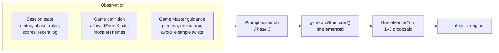
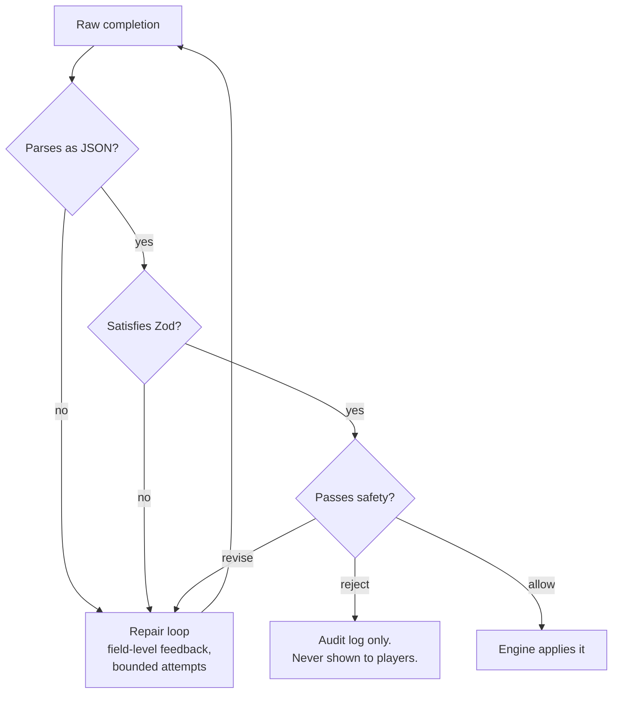

# AI Architecture

> **Phase 1 status.** The contract, the provider abstraction, and the structured-generation pipeline
> with its repair loop are implemented and tested. The Game Master agent is **not** implemented — it
> is Phase 3; Phase 2 is the deterministic game engine, which involves no AI. This document describes the intended design and marks precisely which parts exist.

---

## The pipeline

```
Game State
    ↓
Game Master Agent          ← planned, Phase 3
    ↓
Gemma (open weights)       ← implemented: ModelProvider port + two adapters
    ↓
Structured GameEvent       ← implemented: gameEventSchema
    ↓
Zod validation             ← implemented: generateStructured() + repair loop
    ↓
Safety validation          ← planned, later phase (taxonomy + contracts implemented)
    ↓
Game Engine                ← implemented: deterministic, no AI (Phase 2)
```

Every arrow narrows what is possible. By the time anything reaches the engine it has been constrained
by a grammar, parsed by a schema, and judged by deterministic rules.

---

## 1. What "agent" means in this project

The word is used narrowly. A TouchGrass agent is:

> a component that observes game state, decides whether to act, and emits a **structured proposal**
> into a validation pipeline.

It explicitly is **not**:

- a thing with tools it can call
- a thing with autonomy over state
- a thing in a loop with itself
- a conversational partner

The Game Master gets one job per turn: look at the session and propose between one and three events.
It cannot query a database, call an API, remember anything beyond what the prompt contains, or apply
its own output. Those capabilities would each add a failure mode, and none of them improve the twist
it writes.

### The agent's actual inputs



Note where the Game Master's personality lives: in `packages/game-definitions`, beside the rules, not
inside the agent. Each game ships its own `persona`, its own list of things to `encourage`, its own
list of things to `avoid`, and hand-written `exampleTwists` for few-shot prompting. Adding a game adds
a voice; it does not touch agent code.

### Why one agent and not a crew

A planner/critic/safety-reviewer trio is the fashionable architecture and the wrong one here:

- **The critic's job is done better by Zod.** "Is `durationSeconds` within range" is a schema
  question, answered in microseconds with a precise error message, not a second inference pass.
- **The safety reviewer's job must not be done by a model at all.** See §4 and
  [SAFETY.md](./SAFETY.md). A model reviewing a model inherits the first one's failure modes.
- **Every extra pass costs a player's patience.** Twelve people are standing in a field. Two
  inference calls where one suffices is a product regression.

Agents get added when a job genuinely needs a model's judgement and cannot be expressed as code. So
far, exactly one job qualifies: writing the twist.

---

## 2. Why an LLM alone is not the game engine

Imagine skipping the architecture and asking a model to run the game directly: feed it state, let it
return new state. It fails on five counts, and each one is a reason a specific piece of the codebase
exists.

**It is not deterministic.** Ask twice, get two answers. A referee that gives different rulings on
identical situations is not a referee. The engine is a pure function, and the test suite pins that:
two replays of the same recorded inputs produce byte-identical state.

**It cannot be audited.** When a parent asks why their child was told to do something, "the model
decided" is not an answer. Every state change in TouchGrass carries a provenance tag — `engine`,
`human`, or `game-master` — so the history shows which changes came from a model. (The event
schema has no field for a model's reasoning; whether to record one is a Phase 3 decision.)

**It cannot be trusted with arithmetic or invariants.** Scores drift. Role maximums get violated. A
game with eleven taggers and one runner is not a game. `assignRoles` enforces the definition's
minimums and maximums as code, and the schema refuses a definition whose roles demand more players
than `minPlayers` allows.

**It has no stable notion of refusal.** "Do not allow a player to join a running game" is a rule a
model will follow most of the time. Most of the time is not a rule. `reduce` returns a typed
`WRONG_STATUS` error, every time, and a test asserts that a terminal session accepts nothing at all.

**It confuses creativity with authority.** The model is genuinely good at the one hard thing — "this
chase has gone static, invent something that will make twelve people laugh and move differently."
That is a creative act. Deciding whether the result is safe, legal, fair, and applicable is a
judicial act. Conflating them is the mistake.

So the division is: **the model proposes, code judges, code executes.**

---

## 3. Why structured output is required

A Game Master turn has to become a state change. Free text cannot, without a parser — and a parser
over model prose is a guessing machine.

Structured output is enforced in two independent layers, and the distinction matters:

### Layer 1 — grammar-constrained decoding

The Zod schema is converted to JSON Schema and handed to the runtime, which constrains the sampler
during generation:

```ts
// packages/ai/src/structured.ts
const jsonSchema = toJsonSchema(schema, schemaName);
// → Ollama:            { format: jsonSchema }
// → OpenAI-compatible: { response_format: { type: 'json_schema', json_schema: { strict: true, ... } } }
```

This is the single biggest reason a **4B** open-weight model is viable here. The question is not "is
the model clever enough to remember the JSON format" — the grammar makes malformed output largely
unreachable. The model only has to be good at the creative part.

`io: 'input'` is passed to the converter deliberately: the schema describes what the model must
_produce_, so fields carrying Zod defaults are optional rather than demanded.

### Layer 2 — Zod validation

Grammar guarantees _shape_, not _meaning_. A model can emit a structurally perfect
`durationSeconds: 300` in a game whose ceiling is 120, or a `delta: 50` when the cap is 10. Only the
schema catches that, so the output is re-validated after generation — always, with no fast path.

### The contract itself

`packages/game-engine/src/events.ts` is the narrow waist of the product. A strict discriminated
union — of which an outside source such as the Game Master may send seven kinds, through
`submitGameEvent` — and a set of deliberately conservative choices:

| Choice                           | Reason                                                               |
| -------------------------------- | -------------------------------------------------------------------- |
| No free-form `data` bag          | Every field is named and typed. A model cannot invent a new effect.  |
| `.strict()` on every branch      | An unexpected key is a rejection, not a shrug.                       |
| Length-bounded strings (3–240)   | A twist must be shoutable across a field and remembered.             |
| Bounded durations (5–600s)       | A model cannot impose a rule lasting an hour.                        |
| Bounded points (1–10)            | A model cannot hand out a thousand points, or take any away.         |
| Zones as text, never coordinates | The system has no map and must not claim spatial authority it lacks. |

The last one is worth dwelling on. `ZONE_CHANGE` takes `zone: "the bench with the missing slat"` —
never a latitude. The system does not know what is on the far side of a hedge, so it never pretends
to. Players own the boundary; the Game Master only references what they already named.

The event schema is the engine's contract, not an AI-specific one: it has no field for a model's
reasoning and no notion of a "turn". Whether the Game Master's output also carries a rationale for
the audit log, and how many events one turn may contain, are Phase 3 decisions that wrap this
schema without changing it.

### Why a discriminated union rather than a loose object

Error quality. Telling a 4B model _"durationSeconds: Too big: expected number to be <=600"_
produces a usable retry. Telling it _"invalid union"_ does not. The union's per-branch errors are what
make the repair loop in the next section actually work.

---

## 4. Why deterministic validation is required

Three validation passes, with a strict ordering and no shortcuts.



**The repair loop is bounded and informative.** On a validation failure, or a reply that is not JSON
at all, the model is told what was wrong, shown its own rejected output, and asked once more. If the
budget runs out the failure is reported as `OUTPUT_NOT_JSON` or `OUTPUT_SCHEMA_INVALID`, whichever the
last attempt was. Transport faults are not repaired; they are thrown to the caller. Small models repair well
when feedback names the field and the constraint. The budget defaults to one extra attempt — past
that, the turn is dropped, because a Game Master that goes quiet for a round is fine and one that
takes twenty seconds is not.

**Safety is deliberately synchronous.** The `SafetyValidator` type signature is not `async`:

```ts
export type SafetyValidator<TProposal, TContext> = (
  proposal: TProposal,
  context: TContext,
) => SafetyVerdict;
```

A check that can await is a check that can hang, time out, and get skipped under load. Forbidding I/O
in the type also forbids the thing we must never do: ask a model whether its own output was safe.

**There is no "unknown" verdict.** `SafetyDisposition` is `allow | revise | reject`. Anything the
validator cannot classify is a reject. A game that fails closed is boring for one round; a game that
fails open is dangerous.

---

## 5. Why open-weight AI is important here

Beyond ideology, four properties of this specific product make open weights the right call:

**Latency is a product feature.** A Game Master turn blocks real people mid-game. Self-hosting means
the deadline, quantisation, batching, and keep-alive are ours to tune. `OLLAMA_KEEP_ALIVE=30m` is set
in `docker-compose.yml` for exactly this reason — a cold model load would blow past the request
timeout between turns.

**The players are often children.** Session content includes names and described locations. With a
local runtime, none of it leaves hardware we control. That is a materially different privacy posture
from "we send it to a vendor and trust the retention policy."

**Cost cannot scale with play.** The Game Master fires every ninety seconds for an hour. Per-token
billing makes the product's core loop the thing you want to avoid doing.

**The safety argument depends on replaceability.** [SAFETY.md](./SAFETY.md) claims the model is never
the final authority. That claim is only credible if the model is a component we can swap, inspect, and
test around — which is what the provider port in §7 provides.

The default is **Gemma 3 4B**: small enough for a laptop, well-behaved under grammar constraints, and
openly licensed.

---

## 6. Why local inference is useful

Separate from the open-weight argument, running the model _locally during development_ changes how the
project can be built and contributed to.

- **A contributor clones and runs the real thing.** `npm run ai:up && npm run ai:pull`. No account,
  no key, no quota. For a Hacktoberfest project that is the difference between a contributor who tries
  the Game Master and one who reads about it.
- **Prompt iteration is free.** Tuning a persona means running a hundred generations. At zero
  marginal cost that is an afternoon; metered, it is a budget conversation.
- **Failure modes are reproducible.** A pinned local model fails the same way twice, so a prompt
  regression is a bug you can write a test around instead of a thing that happened once.
- **The dev contract matches production.** The container exposes the same HTTP interface the GPU host
  will. Development is a scaled-down production, not a different system.

The tests never require a running model. `packages/ai` uses a scripted test double for the repair
loop and `vi.stubGlobal('fetch')` for the adapters, so CI needs no GPU — and the repo ships **no fake
provider** in `src`.

---

## 7. How the model becomes replaceable

One port, two adapters, one registry. Nothing outside `packages/ai/src/provider/` names a runtime.

```ts
export interface ModelProvider {
  readonly id: string;
  readonly model: string;
  readonly baseUrl: string;
  health(options?): Promise<ProviderHealth>;
  generateText(request: GenerateTextRequest): Promise<GenerateTextResult>;
  generateJson(request: GenerateJsonRequest): Promise<GenerateJsonResult>;
}
```

The port is small on purpose — no streaming, no embeddings, no tool calling, no chat-session
abstraction. The Game Master needs one JSON object per turn within a deadline. A port that promises
only what is required is a port any open-weight runtime can satisfy.

**Two adapters ship now because an abstraction with one implementation is an untested guess.**

| Adapter             | Endpoint                    | Structured output                             | Role        |
| ------------------- | --------------------------- | --------------------------------------------- | ----------- |
| `ollama`            | `POST /api/chat`            | `format: <JSON Schema>`                       | Development |
| `openai-compatible` | `POST /v1/chat/completions` | `response_format: { type: 'json_schema', … }` | Production  |

Writing the second one is what proved the port was provider-shaped rather than accidentally
Ollama-shaped. It is also the realistic production path: every way of serving Gemma on a GPU host —
vLLM, TGI, llama.cpp's server — speaks `/v1/chat/completions`. The weights stay open and self-hosted;
only the protocol changes, behind one file.

Swapping is a config change, not a code change:

```bash
MODEL_PROVIDER=openai-compatible
MODEL_NAME=google/gemma-3-12b-it
MODEL_BASE_URL=https://gpu-host.example.com/v1
MODEL_API_KEY=…
```

The registry is a `Record<ModelProviderId, Factory>` rather than a `switch`, so adding a runtime is
one file plus one entry — and TypeScript fails the build if the env schema gains a provider with no
factory.

### What is observable at the boundary

Every generation reports `latencyMs`, `attempts`, `model`, and token usage where the runtime provides
it. Validation failures log the field-level issues and the raw completion. This is the telemetry that
makes prompt work empirical rather than anecdotal, and it is why Sentry (a later phase) has something worth
collecting.

---

## 8. Phase 3: what gets built

| Piece                            | Where                                               |
| -------------------------------- | --------------------------------------------------- |
| Game Master agent (Mastra)       | `packages/ai/src/agent/`                            |
| Prompt assembly from definitions | `packages/ai/src/agent/prompt.ts`                   |
| Turn trigger policy              | when to fire, and when to stay quiet                |
| Hand-off of proposals to engine  | through the engine's event validation (Phase 2)     |
| Golden-prompt regression tests   | real Gemma output, pinned, asserted against schemas |

Mastra is **not installed yet**, deliberately. It arrives with the agent that uses it; the seam it
plugs into — `gameEventSchema` and `generateStructured()` — already exists and is covered by tests.

The deterministic safety validator is specified in [SAFETY.md](./SAFETY.md) and is not part of
Phase 3.
