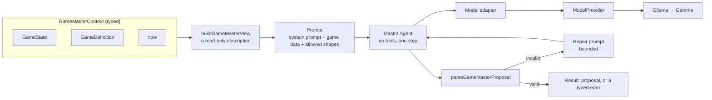
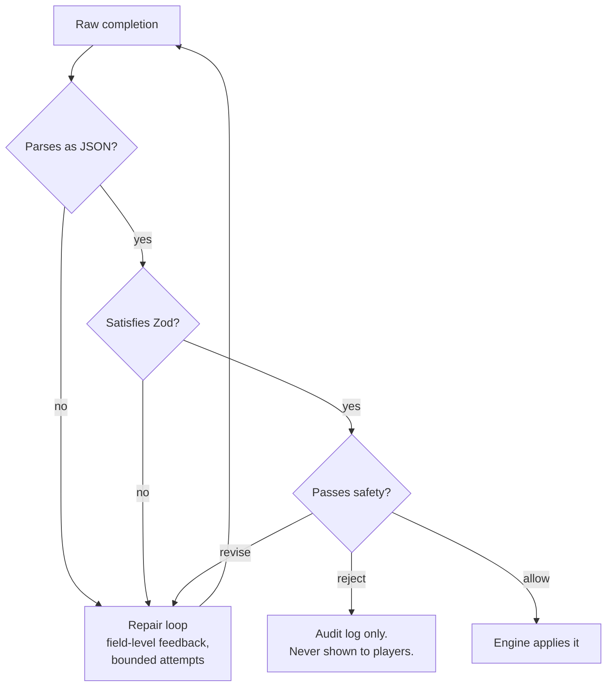

# AI Architecture

> **Status: the Game Master takes part in live games.** A Game Master exists: one Mastra agent,
> running Gemma through a local Ollama, that reads a game and returns a structured proposal. A
> proposal is handed off: the game engine checks that it is legal in the current game, a
> deterministic safety validator then checks it against the game's safety policy, and only then
> does the engine apply it. The multi-session server now asks the Game Master when a round begins,
> applies what passes through the live session, tells the room, and saves the game. It is off by
> default, and a game needs no model to run. The normal tests use a scripted stand-in for the model.
> The manual live test (`npm run ai:live`) and one opt-in test run against the real local
> `gemma3:4b` model.

**AI proposes; schema checks shape; domain validation checks legality; safety validation checks
real-world risk; the deterministic engine executes.**

**Schema-valid does not mean game-valid.** In the Phase 3A live run, real Gemma output that passed
the schema named players (`"123"`), roles (`"merchant"`) and powers (`"speedBoost"`) that did not
exist, and offered a shield to a player who already held one. The schema cannot know any of that;
only the engine, looking at the game, can.

**Domain-valid does not mean safe.** A bonus objective that says "climb the abandoned building" is
well formed and legal in Tag. The engine has no reason to refuse it. The safety validator does.

---

## Who does what

| Role                 | What it is                                                                       | State       |
| -------------------- | -------------------------------------------------------------------------------- | ----------- |
| Claude / Codex       | Development assistants used to write this code. Not part of the running product. | —           |
| **Gemma**            | The runtime model, served locally by Ollama                                      | Integrated  |
| **Game Master**      | **Proposes** at most one game event, with a reason                               | Implemented |
| **Hand-off**         | Passes a proposal to the engine's validator, the safety validator, the engine    | Implemented |
| **Game engine**      | **Decides** whether the event is legal now, and **executes** it                  | Implemented |
| **Safety validator** | **Decides** whether a legal event passes the game's safety policy                | Implemented |

---

## The pipeline

```
GameState + GameDefinition
    ↓
Game Master (Mastra agent)       packages/ai/src/game-master
    ↓
Gemma via Ollama                 ModelProvider + adapter
    ↓
raw proposal                     { rationale, event | null }
    ↓
schema validation                parseGameMasterProposal: shape, and the kinds this game allows
    ↓
state-aware validation           validateExternalEvent (engine): is it legal in this game, now?
    ↓
ValidatedGameEvent               can only be issued by the engine
    ↓
safety validation                validateSafety (safety package): does any safety rule match?
    ↓
SafetyClearedEvent               can only be issued by the safety package
    ↓
deterministic application        applyValidatedEvent (engine)
    ↓
new GameState
```

Every arrow narrows what is possible. A rejection at any stage leaves the game exactly as it was:
nothing is applied, scored or recorded, the event is not rewritten, and the model is not asked again.

In a live game the same pipeline continues past the engine, and starts before the model with a
decision that is not the model's:

```
trigger                          application code: a round began, or trusted code asked
    ↓
  … the pipeline above, against the live session …
    ↓
deterministic application        engine, through the session's room   room.applyEvent
    ↓
broadcast                        the room tells its connections, as for any other change
    ↓
save                             the session handle's own save()
```

See [The Game Master in a live game](#the-game-master-in-a-live-game).

What the safety step is and is not: it is a fixed set of rules over the text and values of the event,
described in [SAFETY.md](./SAFETY.md). It never reads the proposal's `rationale`, which is the model
describing its own proposal and is not evidence of anything. It knows nothing about the place the game
is being played, so passing it means "no rule matched", not "safe".

The safety step belongs to this hand-off, not to the engine. The engine does not depend on the safety
package, so code that calls the engine's `submitGameEvent` or `applyValidatedEvent` directly applies a
legal event with no safety check. What is gated is a Game Master proposal on its way to the engine.

---

## 1. What "agent" means in this project

The word is used narrowly. A TouchGrass agent is:

> a component that observes game state, decides whether to act, and returns a **structured proposal**.

It explicitly is **not**:

- a thing with tools it can call
- a thing with autonomy over state
- a thing in a loop with itself
- a conversational partner

The Game Master has one capability: `propose(context)`. It looks at a game and returns at most one
event, or decides that nothing should happen. It cannot query a database, call an API, remember
anything between calls, or apply its own output.

### The Game Master, as built



| File (`packages/ai/src/game-master/`) | Responsibility                                                |
| ------------------------------------- | ------------------------------------------------------------- |
| `game-master.ts`                      | `createGameMaster`, `propose`, the repair loop, typed errors  |
| `context.ts`                          | `GameMasterContext` and the read-only view shown to the model |
| `prompt.ts`                           | The system prompt and the message builders                    |
| `proposal.ts`                         | The proposal schema and its validation                        |
| `model-adapter.ts`                    | Presents a `ModelProvider` to Mastra as a language model      |

It is imported from `@touchgrass/ai/game-master`, a separate entry point, so code that only needs a
model provider does not load the agent framework.

**What the model is shown.** Not the state object: a description derived from it — the round and
seconds remaining, each present player's role, score and status, what is in force, the last ten
history entries, the event kinds, modifiers and powers this game allows, the validation limits, and
the game's `persona` and `avoid` list.

**What it returns.**

```ts
{ rationale: string, event: ExternalGameEvent | null }
```

`event` uses the engine's own schemas for events that may come from outside it
(`EXTERNAL_EVENT_SCHEMAS` in `packages/game-engine/src/events.ts`). There is no second event model.
`null` means "nothing should happen now".

**What it cannot express.** The engine has no external schema for `ROUND_START`, `ROUND_END`,
`GAME_END`, `PLAYER_OUT`, `POWER_ACTIVATED` or `OBJECTIVE_COMPLETED`, and the external `ROLE_CHANGE`
has no `cause` field. So the Game Master cannot start or end a round or the game, put a player out,
activate a power, complete an objective, or claim that a role change was a tag. No event sets a
score. For each game, the schema given to the model is further narrowed to the kinds that game
allows.

**Outcomes.** `propose` returns a `Result`:

| Outcome             | Meaning                                                                                    |
| ------------------- | ------------------------------------------------------------------------------------------ |
| ok                  | A valid proposal, the number of attempts, and the provider and model used                  |
| `GAME_NOT_ACTIVE`   | No round is running; the model is not called                                               |
| `INVALID_CONTEXT`   | The definition is not the game being played; the model is not called                       |
| `MODEL_UNAVAILABLE` | The runtime failed; `modelErrorCode` says how (unreachable, timeout, model not pulled, …)  |
| `INVALID_PROPOSAL`  | The model replied, but not validly, after every attempt; includes the issues and the reply |

If Ollama is down or the model has not been pulled, the caller gets `MODEL_UNAVAILABLE`. Nothing
falls back to another model.

**Why it cannot change a game.** The agent has no tools. The Game Master object has one method. The
module imports types and schemas from the engine and none of its entry points; a test reads the
source files and fails if that changes. Its only output is a returned value. A test passes it a
deeply frozen game and checks it is unchanged.

### The hand-off, as built

`@touchgrass/ai/handoff` (`packages/ai/src/handoff/handoff.ts`) is the only place in this package
that passes anything to the engine. It is a separate module from the Game Master, and it contains no
game rules.

| Function                     | What it does                                                                 |
| ---------------------------- | ---------------------------------------------------------------------------- |
| `validateGameMasterProposal` | Schema check, then the engine's state-aware check. Changes nothing.          |
| `handOffProposal`            | Validates, then has the engine apply the validated event. No model involved. |
| `runGameMasterTurn`          | Asks the Game Master for a proposal, then calls `handOffProposal`.           |

- **Raw proposal.** Treated as untrusted even when it came from `GameMaster.propose`; its shape is
  checked again.
- **Schema validation.** Rejects malformed proposals, engine-only event kinds, a `ROLE_CHANGE` with a
  `cause`, and kinds the game does not allow. Failure stage: `SCHEMA`.
- **State-aware validation.** Done by the engine (`validateExternalEvent`), with the same rules it
  applies to every event: the players, roles and powers named must exist; a player must not already
  hold the power; role limits must hold; the modifier must be allowed; a round must be running.
  Failure stage: `STATE`, carrying the engine's error.
- **Validated event.** A `ValidatedGameEvent` is issued only by the engine and is bound to the state
  it was checked against. An object that merely has the same shape is refused, and so is one
  validated on a different branch of the game or before the game moved on. "Validated" means legal
  in the game, not safe.
- **Game definition.** Never taken from the caller: the hand-off and the engine both look it up from
  the state's game id, so a modified definition cannot widen what is accepted.
- **Deterministic application.** `applyValidatedEvent` applies it. The engine validates again as it
  applies, as it does for every event. Failure stage: `APPLICATION`.
- **Null proposal.** `event: null` is a legitimate answer. The outcome is `NO_EVENT`, the same state
  object is returned, and nothing is recorded. The rationale is explanatory text from a model; it is
  kept for the record and never read as a fact about the game. (A real reply paired `event: null`
  with a rationale that was untrue.)
- **Failure.** A typed error, and the caller's state exactly as it was. Nothing is partly applied.
  Nothing is repaired or guessed: an unknown player is not mapped to a real one, a missing role or
  power is not created, and the model is not asked again after a state rejection.

In a live run of this path, real Gemma proposals produced each outcome: one applied
(`TIME_EXTENSION`), one refused by the engine (a shield for a player who already held one), and two
no-ops.

### Where Mastra fits

Mastra provides the agent: instructions, the model call, and structured output. The Game Master is a
single `Agent` with `tools: {}`, limited to one step. There are no workflows, no memory, no other
agents, and no Mastra server.

The agent's model is not a Mastra or AI-SDK provider for Ollama. It is `createProviderLanguageModel`,
a small adapter that implements the language-model interface Mastra expects on top of this project's
existing `ModelProvider`. So the runtime is still chosen in one place, and no OpenAI client library
is a dependency.

### What is not used yet

Each game definition also carries `encourage` and `exampleTwists`. They were written in Phase 1,
before the event vocabulary existed, and several describe things no event can express ("taggers may
only hop"). They are **not** put in the prompt, because the prompt tells the model not to invent
mechanics the game does not have.

### Why one agent and not a crew

A planner/critic/safety-reviewer trio is the fashionable architecture and the wrong one here:

- **The critic's job is done better by Zod.** "Is `durationSeconds` within range" is a schema
  question, answered in microseconds with a precise error message, not a second inference pass.
- **The safety reviewer's job must not be done by a model at all.** See §4 and
  [SAFETY.md](./SAFETY.md). A model reviewing a model inherits the first one's failure modes.
- **Every extra pass costs a player's patience.** Twelve people are standing in a field. Two
  inference calls where one suffices is a product regression.

Agents get added when a job genuinely needs a model's judgement and cannot be expressed as code. So
far, exactly one job qualifies: writing the twist.

---

## 2. Why an LLM alone is not the game engine

Imagine skipping the architecture and asking a model to run the game directly: feed it state, let it
return new state. It fails on five counts, and each one is a reason a specific piece of the codebase
exists.

**It is not deterministic.** Ask twice, get two answers. A referee that gives different rulings on
identical situations is not a referee. The engine is a pure function, and the test suite pins that:
two replays of the same recorded inputs produce byte-identical state.

**It cannot be audited.** When a parent asks why their child was told to do something, "the model
decided" is not an answer. Every state change in TouchGrass carries a provenance tag — `engine`,
`human`, or `game-master` — so the history shows which changes came from a model. (The event
schema has no field for a model's reasoning; whether to record one is a Phase 3 decision.)

**It cannot be trusted with arithmetic or invariants.** Scores drift. Role maximums get violated. A
game with eleven taggers and one runner is not a game. `assignRoles` enforces the definition's
minimums and maximums as code, and the schema refuses a definition whose roles demand more players
than `minPlayers` allows.

**It has no stable notion of refusal.** "Do not allow a player to join a running game" is a rule a
model will follow most of the time. Most of the time is not a rule. `reduce` returns a typed
`WRONG_STATUS` error, every time, and a test asserts that a terminal session accepts nothing at all.

**It confuses creativity with authority.** The model is genuinely good at the one hard thing — "this
chase has gone static, invent something that will make twelve people laugh and move differently."
That is a creative act. Deciding whether the result is safe, legal, fair, and applicable is a
judicial act. Conflating them is the mistake.

So the division is: **the model proposes, code judges, code executes.**

---

## 3. Why structured output is required

A Game Master turn has to become a state change. Free text cannot, without a parser — and a parser
over model prose is a guessing machine.

Structured output is enforced in two independent layers, and the distinction matters:

### Layer 1 — grammar-constrained decoding

The Zod schema is converted to JSON Schema and handed to the runtime, which constrains the sampler
during generation:

```ts
// The Game Master gives Mastra a Zod schema; Mastra passes it to the model as a JSON Schema
// response format; the adapter hands that to the provider:
// → Ollama:            { format: jsonSchema }
// → OpenAI-compatible: { response_format: { type: 'json_schema', json_schema: { strict: true, ... } } }
```

This is the single biggest reason a **4B** open-weight model is viable here. The question is not "is
the model clever enough to remember the JSON format" — the grammar makes malformed output largely
unreachable. The model only has to be good at the creative part.

### Layer 2 — Zod validation

Grammar guarantees _shape_, not _meaning_. A model can emit a structurally perfect
`durationSeconds: 300` in a game whose ceiling is 120, or a `delta: 50` when the cap is 10. Only the
schema catches that, so the output is re-validated after generation — always, with no fast path.

### The contract itself

`packages/game-engine/src/events.ts` is the narrow waist of the product. A strict discriminated
union — of which an outside source such as the Game Master may send seven kinds, through
`submitGameEvent` — and a set of deliberately conservative choices:

| Choice                           | Reason                                                               |
| -------------------------------- | -------------------------------------------------------------------- |
| No free-form `data` bag          | Every field is named and typed. A model cannot invent a new effect.  |
| `.strict()` on every branch      | An unexpected key is a rejection, not a shrug.                       |
| Length-bounded strings (3–240)   | A twist must be shoutable across a field and remembered.             |
| Bounded durations (5–600s)       | A model cannot impose a rule lasting an hour.                        |
| Bounded points (1–10)            | A model cannot hand out a thousand points, or take any away.         |
| Zones as text, never coordinates | The system has no map and must not claim spatial authority it lacks. |

The last one is worth dwelling on. `ZONE_CHANGE` takes `zone: "the bench with the missing slat"` —
never a latitude. The system does not know what is on the far side of a hedge, so it never pretends
to. Players own the boundary; the Game Master only references what they already named.

The event schema is the engine's contract, not an AI-specific one: it has no field for a model's
reasoning and no notion of a "turn". Whether the Game Master's output also carries a rationale for
the audit log, and how many events one turn may contain, are Phase 3 decisions that wrap this
schema without changing it.

### Why a discriminated union rather than a loose object

Error quality. Telling a 4B model _"durationSeconds: Too big: expected number to be <=600"_
produces a usable retry. Telling it _"invalid union"_ does not. The union's per-branch errors are what
make the repair loop in the next section actually work.

---

## 4. Why deterministic validation is required

Three validation passes, with a strict ordering and no shortcuts.



The JSON, schema and repair steps are in the Game Master. The safety step and the engine are reached
through the hand-off, which also runs the engine's legality check between the schema and safety. The
diagram's `revise → repair` arrow is **not** implemented: a `revise` verdict is refused like a
`reject`, and nothing asks the model for a safer version.

**The repair loop is bounded and informative.** On a validation failure, or a reply that is not JSON
at all, the model is told what was wrong, shown its own rejected output, and asked once more. If the
budget runs out the Game Master returns `INVALID_PROPOSAL` with the issues and the last reply. A model
that cannot be reached is not repaired; it is reported as `MODEL_UNAVAILABLE`. Small models repair well
when feedback names the field and the constraint. The budget defaults to one extra attempt — past
that, the turn is dropped, because a Game Master that goes quiet for a round is fine and one that
takes twenty seconds is not.

**Safety is deliberately synchronous.** The `SafetyValidator` type signature is not `async`:

```ts
export type SafetyValidator<TProposal, TContext> = (
  proposal: TProposal,
  context: TContext,
) => SafetyVerdict;
```

A check that can await is a check that can hang, time out, and get skipped under load. Forbidding I/O
in the type also forbids the thing we must never do: ask a model whether its own output was safe.

**There is no "unknown" verdict.** `SafetyDisposition` is `allow | revise | reject`. Text the
validator cannot read, and instructions that leave the risky choice open, are violations. A game that
fails closed is boring for one round; a game that fails open is dangerous.

**The hand-off reports where a proposal stopped.** `handOffProposal` and `runGameMasterTurn` return a
failure with a `stage`:

| Stage         | Meaning                                                                 |
| ------------- | ----------------------------------------------------------------------- |
| `PROPOSAL`    | The Game Master produced no proposal (model unavailable, invalid reply) |
| `SCHEMA`      | Not a well-formed proposal for this game, or an engine-only event       |
| `STATE`       | Well formed, but not legal in this game right now                       |
| `SAFETY`      | Legal, but refused by the safety policy; carries the verdict            |
| `APPLICATION` | The engine refused the event as it was applied                          |

Legality is checked before safety, so an event that is both illegal and unsafe is a `STATE` failure.

---

## 5. Why open-weight AI is important here

Beyond ideology, four properties of this specific product make open weights the right call:

**Latency is a product feature.** A Game Master turn blocks real people mid-game. Self-hosting means
the deadline, quantisation, batching, and keep-alive are ours to tune. `OLLAMA_KEEP_ALIVE=30m` is set
in `docker-compose.yml` for exactly this reason — a cold model load would blow past the request
timeout between turns.

**The players are often children.** Session content includes names and described locations. With a
local runtime, none of it leaves hardware we control. That is a materially different privacy posture
from "we send it to a vendor and trust the retention policy."

**Cost cannot scale with play.** The Game Master fires every ninety seconds for an hour. Per-token
billing makes the product's core loop the thing you want to avoid doing.

**The safety argument depends on replaceability.** [SAFETY.md](./SAFETY.md) claims the model is never
the final authority. That claim is only credible if the model is a component we can swap, inspect, and
test around — which is what the provider port in §7 provides.

The default is **Gemma 3 4B**: small enough for a laptop, well-behaved under grammar constraints, and
openly licensed.

---

## 6. Why local inference is useful

Separate from the open-weight argument, running the model _locally during development_ changes how the
project can be built and contributed to.

- **A contributor clones and runs the real thing.** `npm run ai:up && npm run ai:pull`. No account,
  no key, no quota. For a Hacktoberfest project that is the difference between a contributor who tries
  the Game Master and one who reads about it.
- **Prompt iteration is free.** Tuning a persona means running a hundred generations. At zero
  marginal cost that is an afternoon; metered, it is a budget conversation.
- **Failure modes are reproducible.** A pinned local model fails the same way twice, so a prompt
  regression is a bug you can write a test around instead of a thing that happened once.
- **The dev contract matches production.** The container exposes the same HTTP interface the GPU host
  will. Development is a scaled-down production, not a different system.

The tests never require a running model. `packages/ai` uses a scripted stand-in provider, defined in
a test-support file, and `vi.stubGlobal('fetch')` for the HTTP adapters, so CI needs no GPU. No fake
model is used by production code. The one test that calls a real model, `game-master.live.ts`, is
excluded from `npm test` and `npm run verify` and is run by hand with `npm run ai:live`.

---

## 7. How the model becomes replaceable

One port, two adapters, one registry. Nothing outside `packages/ai/src/provider/` names a runtime.

```ts
export interface ModelProvider {
  readonly id: string;
  readonly model: string;
  readonly baseUrl: string;
  health(options?): Promise<ProviderHealth>;
  generateText(request: GenerateTextRequest): Promise<GenerateTextResult>;
  generateJson(request: GenerateJsonRequest): Promise<GenerateJsonResult>;
}
```

The port is small on purpose — no streaming, no embeddings, no tool calling, no chat-session
abstraction. The Game Master needs one JSON object per turn within a deadline. A port that promises
only what is required is a port any open-weight runtime can satisfy.

**Two adapters ship now because an abstraction with one implementation is an untested guess.**

| Adapter             | Endpoint                    | Structured output                             | Role        |
| ------------------- | --------------------------- | --------------------------------------------- | ----------- |
| `ollama`            | `POST /api/chat`            | `format: <JSON Schema>`                       | Development |
| `openai-compatible` | `POST /v1/chat/completions` | `response_format: { type: 'json_schema', … }` | Production  |

Writing the second one is what proved the port was provider-shaped rather than accidentally
Ollama-shaped. It is also the realistic production path: every way of serving Gemma on a GPU host —
vLLM, TGI, llama.cpp's server — speaks `/v1/chat/completions`. The weights stay open and self-hosted;
only the protocol changes, behind one file.

Swapping is a config change, not a code change:

```bash
MODEL_PROVIDER=openai-compatible
MODEL_NAME=google/gemma-3-12b-it
MODEL_BASE_URL=https://gpu-host.example.com/v1
MODEL_API_KEY=…
```

The registry is a `Record<ModelProviderId, Factory>` rather than a `switch`, so adding a runtime is
one file plus one entry — and TypeScript fails the build if the env schema gains a provider with no
factory.

### What is observable at the boundary

Every generation reports `latencyMs`, `attempts`, `model`, and token usage where the runtime provides
it. Validation failures log the field-level issues and the raw completion. This is the telemetry that
makes prompt work empirical rather than anecdotal, and it is why Sentry (a later phase) has something worth
collecting.

---

## The Game Master in a live game

`packages/server/src/game-master-turns.ts` is where the Game Master meets a running session. It is
wiring: it holds no game rule and no safety rule.

```
LLM proposes  →  schema validates structure  →  engine validates legality
              →  deterministic safety validates safety  →  engine executes
              →  realtime broadcast  →  persistence
```

**Who decides when.** The application does, never the model. The trigger policy is one function,
`gameMasterTriggerFor`, over what the engine recorded:

| Trigger       | When                                                                  |
| ------------- | --------------------------------------------------------------------- |
| `round_start` | A change the room broadcast contains the engine's `ROUND_START` event |
| `manual`      | Trusted server code calls `server.runGameMaster(sessionId)`           |

There is no loop, no timer and no polling. The Game Master's own event does not contain a
`ROUND_START`, so it cannot cause itself to be asked. A turn is one model call (plus at most one
repair attempt inside the agent) and proposes at most one event.

**One event per turn.** The proposal schema is `{ rationale, event | null }`, strictly. A reply
with a list of events, a second event, or any extra field is not a proposal and is refused whole.
More than one event in a round takes more than one turn.

**What the model is given.** A read-only view built from the game: its definition, the round, the
players' ids, names, roles and scores, what is in force, the last ten history summaries, and what
it may propose. It is never given a player token, the host token, the token key, the join code (the
engine's first history summary names it, and it is redacted from the view), the random seed, the
session id, a connection, the store, or any configuration. The state object it is shown is frozen.

**What the model can reach.** Nothing that acts. The agent is built with no native tools. It is
called with a value and returns a value. It is never handed the session, the room, the engine, the
store or a socket, and the code that asks it imports no file, shell or network API. If the
application lists read-only [tools](#tools), the model may ask a question about its own game and
is given the answer; that is all a tool is.

**Where a turn can stop.** Each of these ends the turn with nothing applied, nothing broadcast and
nothing saved, and the game carries on:

| What happened                                      | Outcome    | Stage         |
| -------------------------------------------------- | ---------- | ------------- |
| The session is closed, or the game is not running  | `SKIPPED`  | —             |
| The model runtime is unreachable or has no model   | `FAILED`   | `PROPOSAL`    |
| The model did not answer within the time limit     | `FAILED`   | `PROPOSAL`    |
| The reply was not a valid proposal, after a repair | `FAILED`   | `PROPOSAL`    |
| The proposal is not one for this game              | `REJECTED` | `SCHEMA`      |
| The engine says the event is not legal now         | `REJECTED` | `STATE`       |
| A safety rule matched, or the event is unreadable  | `REJECTED` | `SAFETY`      |
| The engine refused it as it was applied            | `REJECTED` | `APPLICATION` |
| The session was unloaded while the model thought   | `SKIPPED`  | —             |

`APPLIED` and `NO_EVENT` are the two ways a turn succeeds.

**The game it is judged against.** A model takes time. The proposal is validated against the game
as it is when the answer arrives, not as it was when the question was asked, and validation, the
safety check and application happen in one turn of the event loop. If the game ended meanwhile, the
engine refuses the event.

**After the engine.** The room broadcasts the engine's result to that session's connections with
the same `update` message as any other change. Then the handle's `save()` is called. If the save
fails, the event stays applied and unsaved, and the record says so.

**Concurrency and lifecycle.** Turns for one session run one at a time, in order; each sees the
game the previous one left. Turns for different sessions do not wait for each other, and there is
no lock across sessions. The model is always asked with a time limit
(`GAME_MASTER_TIMEOUT_MS`, default 20 seconds). A waiting model does not count as use: the session
can be evicted meanwhile, and the late answer is then dropped. A turn never loads a session, so it
cannot bring an evicted one back.

**The record.** Each turn produces one record for `onAudit`: an invocation id, the session id, the
trigger, the provider and model, the outcome, the stage and a code for a failure, the kind of event
proposed, the number of attempts, and whether it was saved. It never contains the prompt, the reply,
the rationale, a player, or a token. Nothing stores these records; the development server prints
them.

### Configuration

| Variable                   | Meaning                                          | Default                  |
| -------------------------- | ------------------------------------------------ | ------------------------ |
| `GAME_MASTER_ENABLED`      | Give the multi-session server a Game Master      | `false`                  |
| `GAME_MASTER_TIMEOUT_MS`   | How long one turn may wait for the model         | `20000`                  |
| `GAME_MASTER_TOOLS`        | Tools it may use, e.g. `game_history,game_rules` | none                     |
| `MODEL_PROVIDER`           | `ollama` or `openai-compatible`                  | `ollama`                 |
| `MODEL_NAME`               | The model tag                                    | `gemma3:4b`              |
| `MODEL_BASE_URL`           | Where the runtime listens                        | `http://localhost:11434` |
| `MODEL_REQUEST_TIMEOUT_MS` | One request to the runtime                       | `30000`                  |
| `MODEL_MAX_RETRIES`        | Transport retries                                | `2`                      |
| `MODEL_TEMPERATURE`        | Sampling temperature                             | `0.8`                    |

```
MONGODB_URI=mongodb://127.0.0.1:27017 GAME_MASTER_ENABLED=true npm run sessions:dev
```

With `GAME_MASTER_ENABLED` unset, the model code is not loaded, no model is asked, and Ollama does
not need to be installed. None of these values is sent to the model or to a client.

### Testing

Every test of the pipeline uses a stand-in for the model: either a fake Game Master that returns
what the test says, or the real Mastra agent over a scripted `ModelProvider`. They cover each row of
the table above, isolation between sessions, serialization within one, the trigger policy, the
session lifecycle, and the whole path over real sockets. One test runs against the real runtime and
only when asked:

```
GAME_MASTER_LIVE_TEST=1 npx vitest run packages/server/src/game-master.test.ts -t "with the real model"
```

`npm run verify` needs no model runtime.

---

## Tools

The Game Master may be given a short list of read-only tools: narrow questions it can ask about the
one game it is looking at. Tools do not make it an agent that acts. It still observes, proposes a
value, and stops; everything after that is the same deterministic pipeline.

```
model  →  { "tool": { "name": …, "input": … } }     a request, as structured output
       →  the application checks and runs it          never the model, never Mastra
       →  the answer goes back as data
       →  model  →  { "rationale": …, "event": … }    a proposal, into the usual pipeline
```

**How a tool call works.** The Mastra agent is still built with `tools: {}`, so the model is never
offered a native tool and the runtime never executes one. A tool call is a reply in a second
structured-output shape, which the Game Master module recognises, checks and runs itself, and then
asks the model again with the answer. This works with a model that has no native tool calling,
which the local Gemma does not.

**The tools that exist.** Two, both defined in `packages/ai/src/tools/game-tools.ts`:

| Tool           | Answers                                                                                    |
| -------------- | ------------------------------------------------------------------------------------------ |
| `game_history` | Entries of this game's record further back than the ten the model is always shown          |
| `game_rules`   | How this game is scored, round length, proposal limits, and the risks its designers listed |

There is no tool for the players, the round, the time left or what is in force: the model is given
those with every request, and a tool that repeated them would cost a model call and add nothing.

**The security model.**

| Rule                                | How it is enforced                                                                            |
| ----------------------------------- | --------------------------------------------------------------------------------------------- |
| The application decides which exist | A fixed list passed to `createGameMaster({ tools })`. No discovery, no plugins                |
| A tool is on the list or is refused | `UNKNOWN_TOOL`. The name the model asked for is not even recorded                             |
| Input fits the tool's schema        | `INVALID_ARGUMENTS`, checked before the tool runs                                             |
| A tool cannot name another session  | No tool takes a session id, and a tool is handed one game's frozen state only                 |
| A tool cannot change anything       | It is given a frozen state and nothing else: no session, room, store or socket                |
| A tool answers in time              | `TOOL_TIMEOUT` after 2 seconds by default                                                     |
| Output fits the tool's schema       | `INVALID_OUTPUT`                                                                              |
| Output is small                     | `OUTPUT_TOO_LARGE` above 4 KB by default                                                      |
| A tool that throws is contained     | `TOOL_FAILED`. The model is told the code and never the message or the stack                  |
| The game is still wanted            | `SESSION_UNAVAILABLE`: no tool is run for a session that has been closed                      |
| The loop is the application's       | At most 2 tool calls per turn by default, never more than 4. Then only a proposal is accepted |

A failed tool call is an answer to the model, not an exception: the turn goes on, and the game is
unaffected. Using a tool earns no trust. Whatever the model proposes afterwards goes through the
schema, the engine and the safety validator exactly as before.

**What tools are not.** They are not shell, files, network, database or WebSocket access, and none
of those exists as a tool. They cannot mutate a game. A future tool that should cause a change must
return a proposal, which then takes the same path as any other.

**Off by default.** With no tools listed, the model is asked exactly as it was before tools
existed: the same prompt, the same output schema, the same requests.

## The record of a turn

Every Game Master turn in a live session produces one structured record:

| Field               | Meaning                                                                        |
| ------------------- | ------------------------------------------------------------------------------ |
| `invocationId`      | An id for the turn, unique within the process                                  |
| `sessionId`         | Which session                                                                  |
| `trigger`           | `round_start` or `manual`                                                      |
| `provider`, `model` | Which model was asked                                                          |
| `at`, `durationMs`  | When the turn started and how long it took                                     |
| `outcome`           | `APPLIED`, `NO_EVENT`, `REJECTED`, `FAILED` or `SKIPPED`                       |
| `stage`, `code`     | Where a refusal or failure happened, and a stable code                         |
| `eventType`         | The kind of event proposed, when a proposal got that far                       |
| `attempts`          | How many replies the model was asked for                                       |
| `toolCalls`         | For each tool call: the tool's name, whether it answered, a code, its duration |
| `saved`             | For `APPLIED`: whether the changed game was then saved                         |

It never contains a prompt, a reply, a rationale, a tool's input or output, a player, a token or a
key. The schema result, the safety result and the engine result are all in `outcome` and `stage`:
`REJECTED` at `SCHEMA`, `SAFETY`, or `STATE`/`APPLICATION`.

**It is not stored.** The record goes to a callback, to the structured log, and into a bounded
in-memory list of the most recent ones (`server.recentGameMasterAudits()`). Persisting it was
considered and left out: the store keeps one snapshot per session and nothing else, and an audit
trail would need a second collection and a second interface. That is a persistence redesign, not
an addition, so it is recorded here as a limitation instead. Because the record is separate from
the game, a listener that fails, or a reporter that fails, cannot undo an event the engine applied.

## Evaluation

`@touchgrass/ai/eval` is a harness that runs a case through the real pipeline and says what
happened:

```ts
const result = await runEvalCase(evalCase);
// { caseId, passed, expected, actual, stage?, reason?, durationMs }
```

A case names a game state, what the model replies, and what must follow. The real Game Master
agent, schema, engine validator, safety validator and engine run over it. Only the model is
replaced, by a script, so an evaluation is exact and needs no model runtime.

Every case is also held to four invariants, whatever it expects: a turn that applied nothing left
the game untouched; an applied event is recorded by the engine as the Game Master's; the join code
was never sent to the model; the model was never offered a native tool.

**Golden scenarios.** `GOLDEN_CASES` is the fixed set: a safe event, an unsafe event, an invalid
event, a decision to do nothing, malformed output, a critical hazard (with and without claimed
supervision), an unknown or lifecycle event, an engine refusal, a model that is away or slow, and
every way a tool call can succeed or fail, including a tool that is not on the list, a call that
names another session, and a model that only ever asks for tools. They assert outcomes and stages,
never wording, so a prompt can be rewritten without touching them. Session isolation and the
persistence and realtime results need a server and are covered in the server package's tests.

**Safety regression.** `packages/safety/src/regression.test.ts` is separate from all of this and
uses no model code at all. See [SAFETY.md](./SAFETY.md#the-regression-suite).

**Live evaluation.** Opt-in, against the real runtime:

```
GAME_MASTER_LIVE_EVAL=1 npm run ai:live
```

It asks the real model for a proposal in a fixed set of games, with and without tools, puts every
answer through the real pipeline, and prints the valid structured output rate, schema rejection
rate, safety rejection rate, engine acceptance rate, timeout rate, tool-call success rate and
latency. These are measurements, not pass marks. What it asserts is only that every turn ended in
a known way and no invariant broke. `GAME_MASTER_LIVE_EVAL_RUNS` sets how many turns per game
(default 3).

One run on this project's development machine, `gemma3:4b` on local Ollama, 15 turns: 15 well-formed
proposals, 14 applied and 1 decision to do nothing, no schema or safety rejections, no timeouts,
every tool call answered, median 2.3 seconds a turn. In that run 12 of the 14 events were a
`TIME_EXTENSION`: the model is reliable in form and narrow in what it chooses. That is one small
sample from one machine, not a benchmark.

## 8. What comes next

Not built:

| Piece                                    | Notes                                                                                             |
| ---------------------------------------- | ------------------------------------------------------------------------------------------------- |
| Storing the record of a turn             | Kept in memory and logged. Nothing persists it: that needs a second store, not built              |
| Showing safety verdicts                  | The record says a proposal was refused for safety, not which rule matched. There is no UI         |
| A Game Master for the single-game server | Only the multi-session server (`startSessionServer`) has one                                      |
| Tools that act                           | Every tool is read-only. Nothing a tool does can change a game                                    |
| Native tool calling                      | Not used. Tool requests are structured output, checked and run by the application                 |
| More triggers                            | Only a round beginning, and an explicit call                                                      |
| Limits on how often events are proposed  | One turn per round start. The engine still accepts any number of valid events from explicit calls |
| Host control over the Game Master        | A host cannot pause, veto or configure it from a client                                           |
| Prompt evaluation                        | Recorded real outputs, asserted against the schemas                                               |

`generateStructured()` in `structured.ts` predates the Game Master. It is still tested and exported,
but the Game Master does not use it; it has its own repair loop around the Mastra agent.
