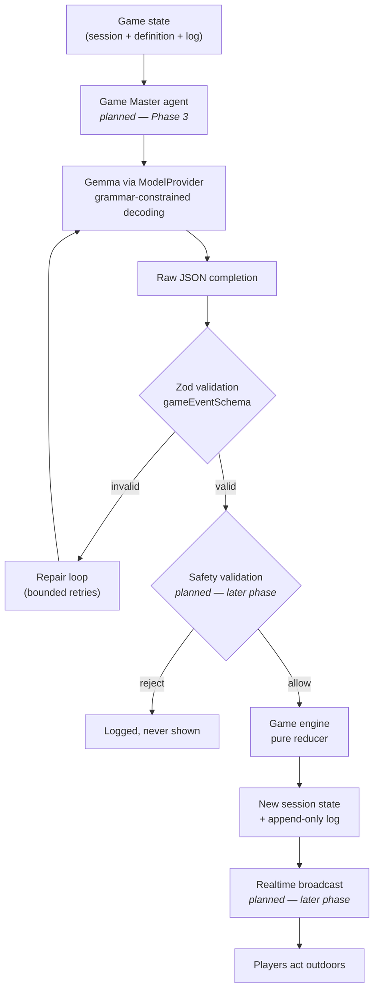
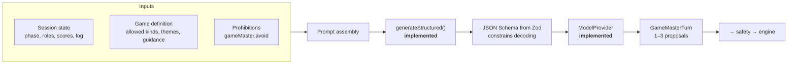
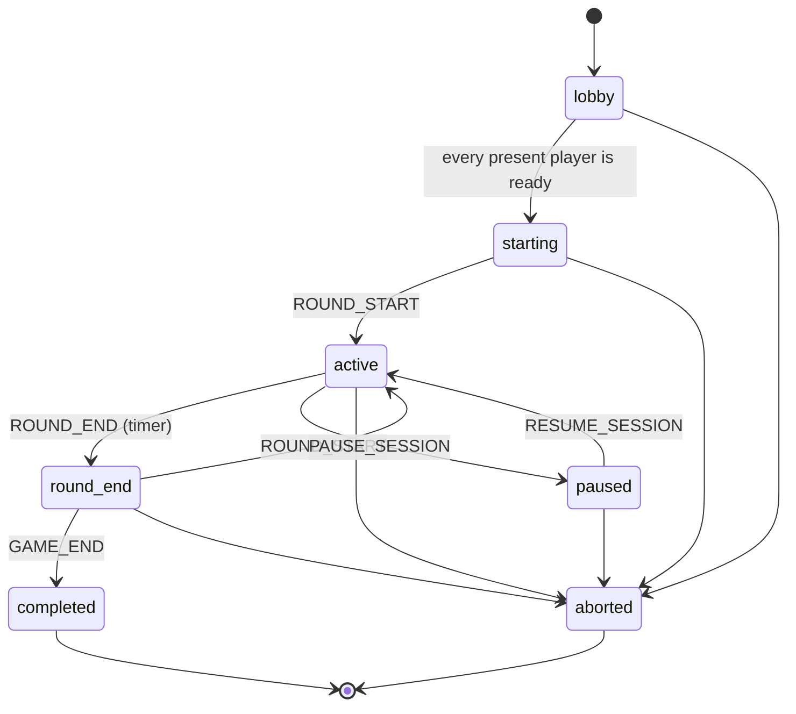
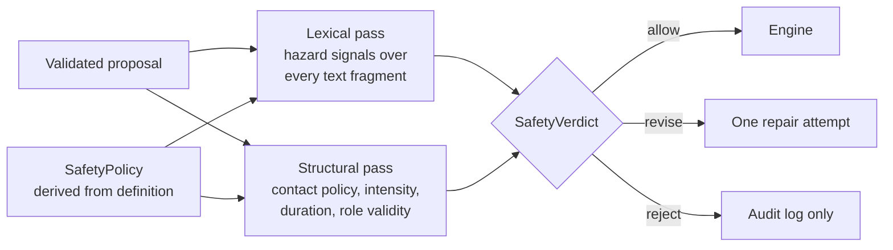
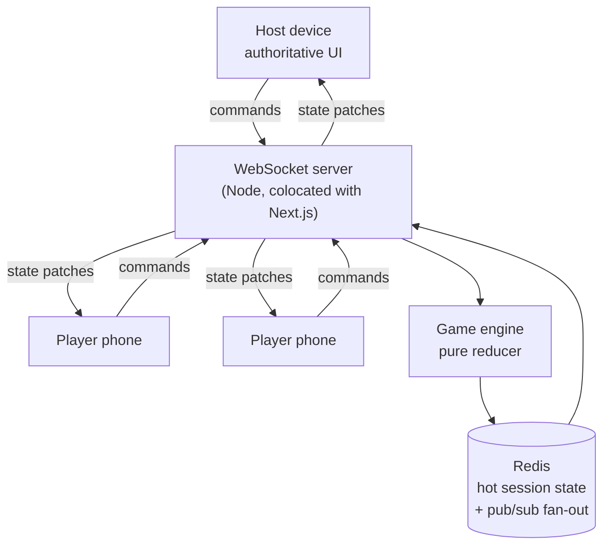
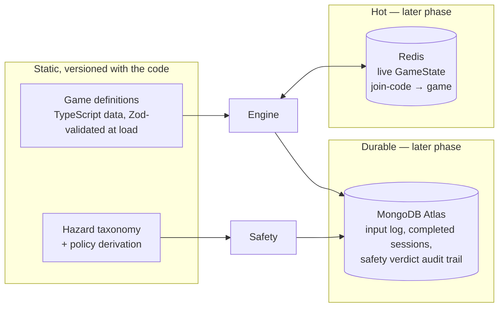
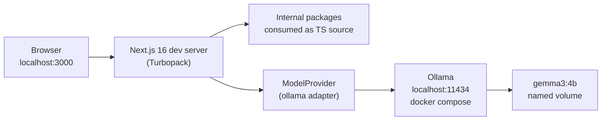
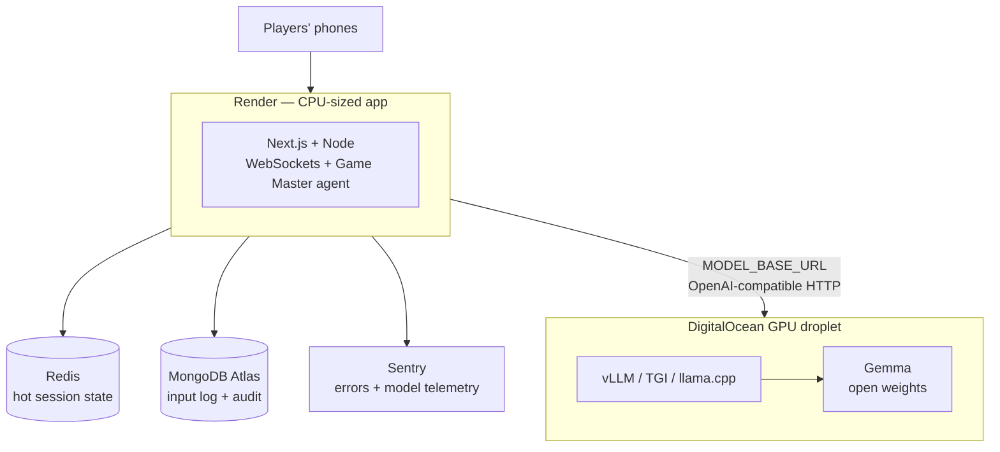
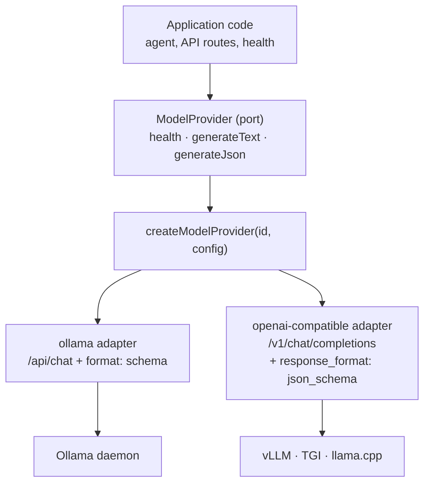

# Architecture

> Phase 1 (foundation) is implemented. Sections describing later phases are marked **planned** and
> say what exists today. Nothing in this document describes code that is not in the repository
> unless it carries that marker.

---

## 1. Product concept

TouchGrass is a platform for playing **real outdoor games** — tag, hide & seek, ice & fire, treasure
hunts, nature challenges — in which an open-weight language model acts as **Game Master**.

A group opens the app in a park, picks a game, and the phone becomes the referee. It assigns roles,
walks them through agreeing a boundary, and then — while the round is running — issues twists:

> "Taggers may only move by hopping on one foot for the next sixty seconds."
>
> "The playable area is now everything between the bench and the gate. Anyone outside that line has
> sixty seconds to move inside it."
>
> "Your next landmark has four legs but never walks, and it has been sat on more than it has been
> noticed."

The design constraint that shapes everything else: **the game happens in the world, not on the
screen.** The phone's job is to referee, and a referee that takes eight seconds to make a call while
twelve people stand still is a bad referee. So latency, offline capability, and failure behaviour are
product requirements, not operational details.

### Why this needs a generative model

A fixed list of twists is stale on the second play. Three things genuinely require generation:

| Capability         | Why a static list cannot do it                                                                      |
| ------------------ | --------------------------------------------------------------------------------------------------- |
| Situated riddles   | A treasure hunt must describe _this_ park — the bench with the missing slat, the third lamp post.   |
| Live rebalancing   | "Ice is winning, four players are frozen" needs a response fitted to that state, phrased for voice. |
| Pacing and variety | Twenty minutes of tag needs a dozen twists that do not repeat and escalate sensibly.                |

### Why it is not a game with a chatbot bolted on

A chatbot produces text beside the game. This Game Master produces **events that change the rules of
play** — which means its output must be structured, bounded, auditable, and refusable. Those four
requirements are what produce the architecture below.

---

## 2. Why open-weight AI is central

The model is not an optional enhancement; it is the component that makes the product possible, and it
being **open-weight and self-hosted** is a design decision with concrete consequences.

| Property                    | Consequence for this product                                                                                                                          |
| --------------------------- | ----------------------------------------------------------------------------------------------------------------------------------------------------- |
| **Self-hosted latency**     | A Game Master turn blocks real people in a field. We tune the deadline, quantisation, and keep-alive ourselves rather than metering a vendor's queue. |
| **Privacy by locality**     | Players are often children. Names, described locations, and chosen landmarks never leave hardware we control.                                         |
| **No per-token cost**       | The Game Master can fire on a timer every ninety seconds for an hour without anyone watching a bill.                                                  |
| **Offline capability**      | Parks have bad signal. A local runtime means the referee works on a laptop hotspot, or on none.                                                       |
| **Inspectable + swappable** | The safety argument rests on deterministic validation, not on trust in a model. That only holds if the model is a replaceable part.                   |

The default is **Gemma 3 4B** via Ollama in development. Small enough to run on a laptop, and good
enough at grammar-constrained JSON to drive the event contract — see [AI.md](./AI.md) for why size is
less important here than structured decoding.

---

## 3. High-level architecture

The central principle:

```
AI PROPOSES  →  VALIDATOR CHECKS  →  GAME ENGINE EXECUTES  →  REALTIME BROADCASTS  →  PLAYERS ACT
```

The LLM never mutates game state. It emits a structured _proposal_; deterministic code decides
whether that proposal becomes an event.



Three properties hold at every arrow:

1. **One direction of trust.** Data flows from less trusted to more trusted through a validator.
   Nothing downstream of a validator ever re-accepts raw model output.
2. **Every refusal is a value, not an exception.** `Result<T, E>` is used throughout, so a rejected
   proposal or a refused command is a branch the compiler forces callers to handle.
3. **Every state change is logged with its provenance.** Each log entry records whether it came from
   the engine, a human, or the Game Master.

---

## 4. Agent architecture

> **Phase 1 status:** the contract and the generation machinery exist. The agent itself is Phase 3.

An "agent" in this project is narrow and deliberately unglamorous: a component that observes game
state, decides whether to act, and emits a structured proposal into a validation pipeline. It has no
tools, no memory store, and no autonomy over state.



What is already in place:

- **`gameEventSchema`** (`packages/game-engine/src/events.ts`) — the exact shape anything the agent
  suggests must take: a strict discriminated union of event kinds, of which an outside source may send seven. How many events one turn may
  carry is a Phase 3 decision.
- **`generateStructured()`** (`packages/ai/src/structured.ts`) — Zod → JSON Schema → constrained
  generation → Zod validation → bounded repair loop.
- **Per-game guidance as data** — each definition carries a `gameMaster` block with a persona, an
  `encourage` list, an `avoid` list, and hand-written example twists for few-shot prompting.

Phase 3 adds the agent that assembles those inputs into a prompt and decides _when_ to fire.
[AI.md](./AI.md) covers the reasoning in depth.

### Why one agent, not several

A planner/critic/safety-reviewer trio would be the fashionable shape and the wrong one. The critic's
job is done better by Zod, and the safety reviewer's job must be done by deterministic code —
delegating a safety decision to a second model inherits the first model's failure modes and adds
latency to a turn that people are physically waiting on. One agent proposes; code judges.

---

## 5. Game engine architecture

The engine is the **only** thing that can change a game. It is described in full in
[GAME_ENGINE.md](./packages/game-engine/GAME_ENGINE.md); this is the summary.

```
PlayerAction → validation → action processing → GameEvent(s) → event application
             → scoring → win evaluation → GameState
```

Tag and Hide & Seek are fully playable through it with no AI.

**Four inputs, each a pure function of (state, input, supplied time):**

| Input          | Entry point           | Notes                                                         |
| -------------- | --------------------- | ------------------------------------------------------------- |
| Host command   | `reduce`              | Join, leave, pause, resume, abort                             |
| Player action  | `processPlayerAction` | A report of intent; turned into events by the game's rules    |
| External event | `submitGameEvent`     | Host today, Game Master in Phase 3; optional event kinds only |
| Time           | `advanceTime`         | Ends rounds and the game when they are due                    |

**It is pure.** No `Date.now()`, no `Math.random()`, no timers, no I/O, no import from
`packages/ai`. The clock value arrives in `EngineContext`; role assignment uses a seeded RNG stored
in the state.

**It is replayable.** `replay()` rebuilds a game from its recorded inputs; tests assert the result
is identical every time, and that advancing time in one step or many gives the same state.

**It fails closed, as a value.** A refusal is a typed `EngineError` returned through `Result`, and
the caller's state is untouched.



A game starts when its players are ready and completes when its last round ends; there is no start
or complete command. A paused game cannot complete. **Stopping a game is never blocked**: abort is
legal from every non-terminal status.

### Events

The ten kinds of the brief — `ROUND_START`, `ROUND_END`, `ZONE_CHANGE`, `CHALLENGE`, `POWER_UP`,
`RULE_MODIFIER`, `BONUS_OBJECTIVE`, `TIME_EXTENSION`, `ROLE_CHANGE`, `GAME_END` — plus three the
engine derives from player actions: `PLAYER_OUT`, `POWER_ACTIVATED`, `OBJECTIVE_COMPLETED`. There is
no event that sets a score. Scores are a consequence the engine computes when an event is applied,
and each award is recorded on that event's history entry.

An outside source may send only the optional kinds a game supports. It cannot send lifecycle or
derived events, or a `ROLE_CHANGE` that claims to be a tag.

### Role assignment is engine work, not model work

Who chases whom is a fairness decision with hard constraints (minimums, maximums, an overflow role),
not a creative one. `assignRoles` uses a seed-shuffled player list, so the same seed and joining
order give the same roles on any host.

### What is and is not implemented

| Piece                                             | State                                                            |
| ------------------------------------------------- | ---------------------------------------------------------------- |
| Lifecycle, rounds, deterministic time, pause      | Implemented                                                      |
| Tag and Hide & Seek rules, scoring, winners       | Implemented                                                      |
| Shield power (`TAG_IMMUNITY`)                     | Implemented                                                      |
| Zones and freeze periods                          | Stored and expired only; nothing is enforced                     |
| Ice & Fire, Treasure Hunt, Nature Challenge rules | Not designed; definitions are valid but have no rules or scoring |
| Game Master, Mastra, Gemma                        | Phase 3                                                          |
| Safety validator, realtime, persistence           | Later                                                            |

---

## 6. Safety architecture

Covered in full in [SAFETY.md](./SAFETY.md). The architectural commitments:

**The model is never the safety authority.** Not as a reviewer of its own output, not as a reviewer
of another model's output. Safety is a synchronous, deterministic function over validated data. The
`SafetyValidator` type is deliberately not `async` — a check that can await is a check that can hang,
time out, and get skipped under load.

**Safety is a separate pass from schema validation.** Zod answers "is this the right shape". Safety
answers "should a child in a field hear this". A perfectly well-formed `MODIFIER` saying _"cross the
road and touch the far pavement"_ passes Zod and must be rejected by safety.

**Policy is derived, never hand-assembled.** `policyFor(definition)` produces the policy from the
game's own declared contact limits, intensity ceiling, and separation expectations. A host can make a
session stricter; the schema refuses any policy that drops a critical hazard category, and
`maxRuleDurationSeconds` clamps downward only.



**Phase 1 ships the taxonomy and the contracts; a later phase ships the rules.** Fifteen hazard
categories with severity, rationale, and example signals; the three-way verdict type; policy
derivation. The matching engine is not scheduled before the Game Master (Phase 3) — deciding _what_
counts as a hazard was the hard part, and writing rules against a fixed taxonomy is the mechanical
part.

---

## 7. Realtime architecture

> **Planned — later phase.** Nothing realtime exists today, and there is no placeholder package.

The intended shape, and the constraint it has to respect:



Decisions already fixed by the engine design:

- **Clients send player actions and host commands, never state.** Those two unions are the only
  vocabulary a client may use, and the server re-validates every one with Zod regardless of origin.
- **Redis holds hot state; it is not the system of record.** The input log is. A lost Redis key
  costs a replay, not a session.
- **Broadcast is the last step, not a side effect.** The engine returns new state; the transport
  publishes it. The engine has no idea a socket exists.
- **Phones are unreliable by assumption.** Players run, drop signal, and lock screens. State is
  reconciled on reconnect by replaying from the last known sequence number — which is why log
  entries carry a contiguous `sequence`.

---

## 8. Data architecture

> **Planned — later phase** for MongoDB and Redis. Today every piece of state is in-process.



The division of labour:

| Store             | Holds                                                          | Why there                                                                  |
| ----------------- | -------------------------------------------------------------- | -------------------------------------------------------------------------- |
| **Code**          | Game definitions, hazard taxonomy                              | They are reviewed, tested, and versioned with the logic that reads them.   |
| **Redis**         | Live `GameState`, join-code lookup, pub/sub                    | Sub-millisecond reads on the referee path; naturally ephemeral.            |
| **MongoDB Atlas** | Append-only input log, finished sessions, every safety verdict | Durable, queryable, and the basis of the audit trail SAFETY.md commits to. |

**Why the input log is the system of record.** The input log is everything given to a game, with
the time it arrived: host commands, player actions, external events, and time advances. Storing
those rather than snapshots means the
engine's replay property does real work: a session can be reconstructed, a disputed call re-run, and
a safety regression tested against real historical turns. Snapshots would throw that away.

**Why game definitions are not in a database.** A definition carries the prohibitions the Game Master
must obey. Those belong under code review and in the test suite, not in a collection anyone can
hot-edit.

---

## 9. Local development architecture



**One command to a working model.** `npm run ai:up && npm run ai:pull` gives every contributor the
same weights behind the same HTTP contract the production GPU host will expose. The web app is
deliberately _not_ containerised for development — hot reload beats a rebuilt image.

**Internal packages are consumed as TypeScript source.** Each package's `exports` points at
`./src/index.ts`, and `next.config.ts` lists them in `transpilePackages`. There is no per-package
build step, no watch-mode orchestration, no `dist/` to go stale, and no Turborepo to configure. Next
already compiles app code; compiling five small packages alongside it costs nothing measurable.

One consequence worth knowing: relative imports inside packages are **extensionless**
(`from './errors'`, not `'./errors.js'`). Turbopack does not rewrite `.js` → `.ts` the way Vite does,
and `moduleResolution: "Bundler"` makes extensionless correct for both.

**Degraded mode is a first-class state.** With no model running, the app still serves every page —
game rules, roles, phases and safety profiles are local data. `/api/health` reports
`status: "degraded"` with HTTP 200 and a sentence naming the command to fix it. Only the Game Master
is unavailable.

---

## 10. Production architecture

> **Planned — later phase** for deployment. The build output and container already target it.



**The app container and the model host scale separately** — the whole reason inference sits behind
`MODEL_BASE_URL` rather than inside the app image. Serving a page costs a CPU and a few MB; serving a
token costs a GPU. Coupling them would mean paying for GPUs to serve static game rules.

The `Dockerfile` builds Next.js standalone output as a non-root user, with a `HEALTHCHECK` that hits
`/api/health` — the same signal the application itself depends on.

The production path uses the **`openai-compatible`** provider, because every realistic way of serving
Gemma on a GPU host (vLLM, TGI, llama.cpp's server) exposes `/v1/chat/completions`. The model stays
open-weight and self-hosted; only the wire protocol differs, and it differs behind one file.

---

## 11. Model abstraction

Nothing outside `packages/ai/src/provider/` names a model runtime. The application holds a
`ModelProvider` and reads `MODEL_PROVIDER` from validated config.



The port is deliberately small — `health`, `generateText`, `generateJson` — with no streaming, no
embeddings, no tool calling, and no session abstraction. The Game Master needs one JSON object per
turn within a deadline. A port that promises only what is required is a port any open-weight runtime
can satisfy.

**Two adapters ship in Phase 1 on purpose.** An abstraction with one implementation is an untested
guess; writing the second is what proves the port is provider-shaped rather than accidentally
Ollama-shaped. The registry is a `Record` keyed by provider id, so TypeScript fails the build if the
env schema gains a provider with no factory.

Swapping runtimes is a config change:

```bash
MODEL_PROVIDER=openai-compatible
MODEL_NAME=google/gemma-3-12b-it
MODEL_BASE_URL=https://gpu-host.example.com/v1
MODEL_API_KEY=...
```

---

## 12. Failure and fallback strategy

Failures are classified by cause, because the right response differs per cause. A dead daemon needs a
scripted fallback; malformed JSON needs a retry.

| Failure                          | Code                        | Response                                                                                    |
| -------------------------------- | --------------------------- | ------------------------------------------------------------------------------------------- |
| Runtime unreachable              | `PROVIDER_UNREACHABLE`      | Retried within budget, then **degraded mode**: the game continues without twists.           |
| Deadline exceeded                | `PROVIDER_TIMEOUT`          | Retried within budget. The turn is skipped rather than delivered late.                      |
| Model not on the runtime         | `MODEL_NOT_AVAILABLE`       | Not retried. Health surfaces the exact pull command.                                        |
| 4xx from the runtime             | `PROVIDER_HTTP_ERROR`       | **Not retried** — the request was wrong, and repeating it only burns the deadline.          |
| 5xx from the runtime             | `PROVIDER_HTTP_ERROR`       | Retried within budget.                                                                      |
| Completion is not JSON           | `OUTPUT_NOT_JSON`           | Counts as an attempt and enters the same repair loop; the raw text is kept on the failure.  |
| Valid JSON, fails Zod            | `OUTPUT_SCHEMA_INVALID`     | **Repair loop**: the model is told which fields were wrong, once. Then the turn is dropped. |
| Passes Zod, fails safety         | `revise` / `reject` verdict | `revise` → one repair attempt. `reject` → logged, never shown to players.                   |
| Illegal input reaches the engine | a typed `EngineError` code  | Refused as a `Result` value. State is untouched.                                            |
| Environment is invalid           | `CONFIGURATION_INVALID`     | **Fatal at startup**, naming the offending variable. Never a mid-game surprise.             |

Three rules behind that table:

**Degraded is a supported mode, not an outage.** Every bundled game is playable by humans without a
referee — people played tag for millennia. When the Game Master is unavailable the app says so
plainly and the round continues. Returning 503 and taking the deployment down would be a strictly
worse outcome.

**Fail closed on content, fail open on availability.** An unvalidated proposal is dropped, always. An
unavailable model degrades a feature, never blocks the app.

**Timeouts are short and tiered.** Health probes get 3s, because they render in a page. Generation
gets `MODEL_REQUEST_TIMEOUT_MS` (30s default), because it blocks a group of people standing in a
field. Both are bounded, and retries are capped at `MODEL_MAX_RETRIES`.

---

## 13. Roadmap

| Phase   | Scope                                                                                                       | Status       |
| ------- | ----------------------------------------------------------------------------------------------------------- | ------------ |
| Phase 1 | Monorepo, model abstraction, game catalogue, hazard taxonomy                                                | **Complete** |
| Phase 2 | Deterministic game engine: lifecycle, time, actions, events, scoring, winners; Tag and Hide & Seek playable | **Complete** |
| Phase 3 | Game Master: Mastra agent on Gemma, sending validated game events to the engine                             | Next         |
| Later   | Safety validator, realtime (WebSockets + Redis), MongoDB persistence, Sentry, deployment — not scheduled    | Planned      |

**Mastra is not installed yet.** It is the intended agent framework, and it arrives in Phase 3 with
the agent that uses it. Installing a framework ahead of the code that needs it produces a dead
dependency; the seam it plugs into — `gameEventSchema` and `generateStructured()` — already
exists and is tested.

The same reasoning explains the missing `realtime/` and `database/` packages. The suggested structure
listed them; creating empty directories to match a diagram would have made the architecture look
complete while being less honest than a documented gap.
