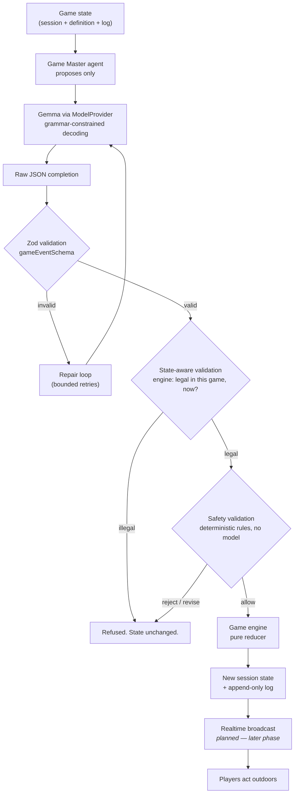
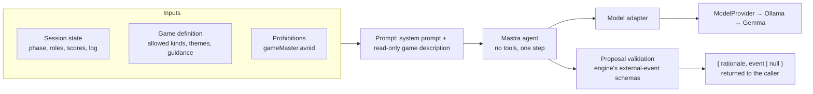
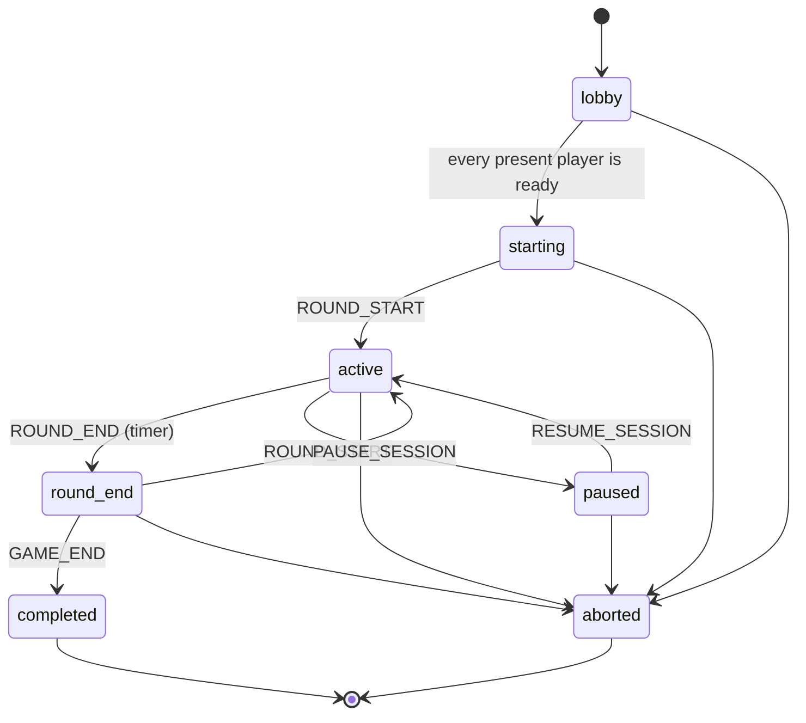
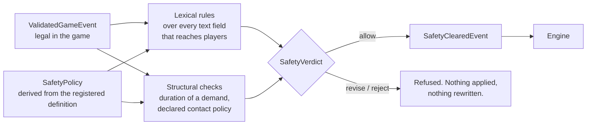
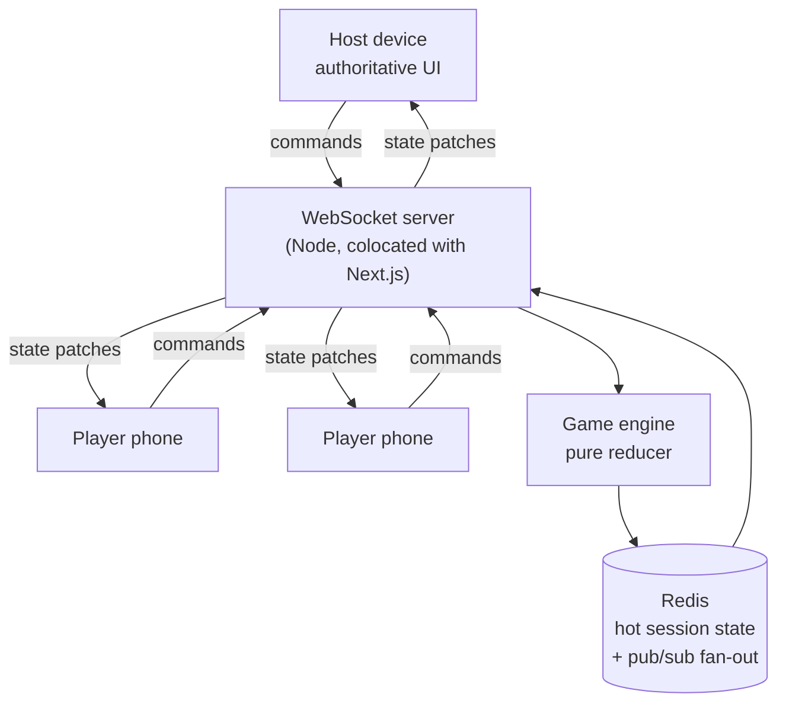
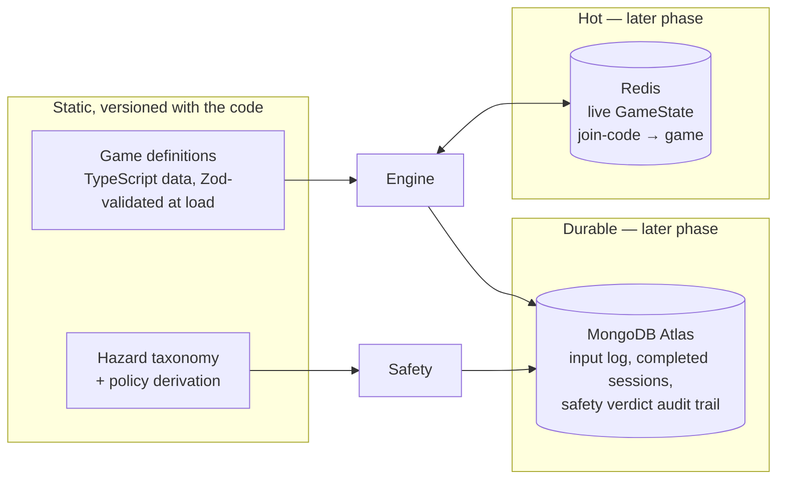
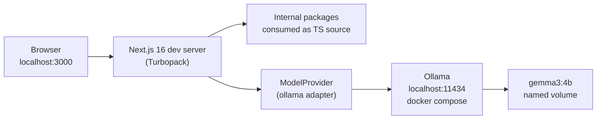
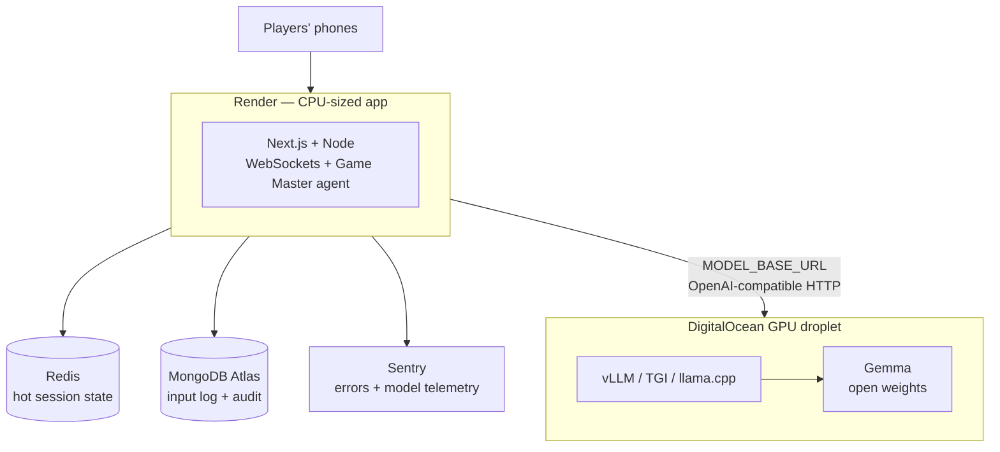
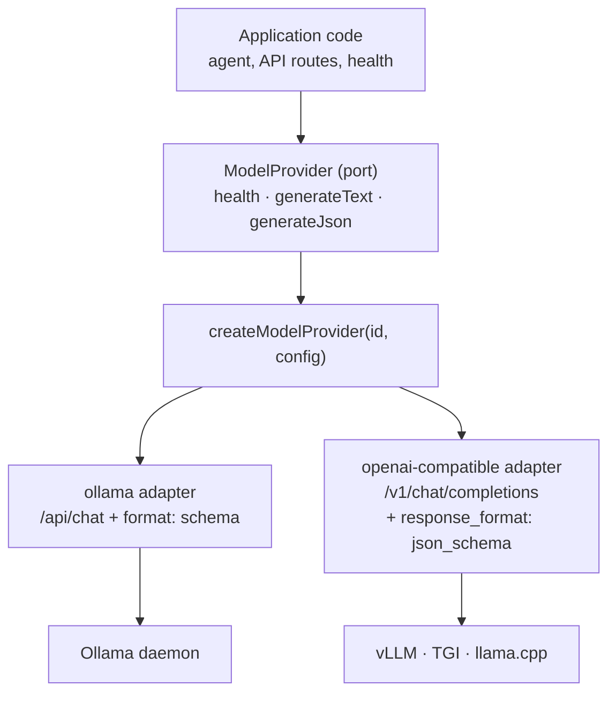

# Architecture

> Phase 1 (foundation) is implemented. Sections describing later phases are marked **planned** and
> say what exists today. Nothing in this document describes code that is not in the repository
> unless it carries that marker.

---

## 1. Product concept

TouchGrass is a platform for playing **real outdoor games** — tag, hide & seek, ice & fire, treasure
hunts, nature challenges — in which an open-weight language model acts as **Game Master**.

A group opens the app in a park, picks a game, and the phone becomes the referee. It assigns roles,
walks them through agreeing a boundary, and then — while the round is running — issues twists:

> "Taggers may only move by hopping on one foot for the next sixty seconds."
>
> "The playable area is now everything between the bench and the gate. Anyone outside that line has
> sixty seconds to move inside it."
>
> "Your next landmark has four legs but never walks, and it has been sat on more than it has been
> noticed."

The design constraint that shapes everything else: **the game happens in the world, not on the
screen.** The phone's job is to referee, and a referee that takes eight seconds to make a call while
twelve people stand still is a bad referee. So latency, offline capability, and failure behaviour are
product requirements, not operational details.

### Why this needs a generative model

A fixed list of twists is stale on the second play. Three things genuinely require generation:

| Capability         | Why a static list cannot do it                                                                      |
| ------------------ | --------------------------------------------------------------------------------------------------- |
| Situated riddles   | A treasure hunt must describe _this_ park — the bench with the missing slat, the third lamp post.   |
| Live rebalancing   | "Ice is winning, four players are frozen" needs a response fitted to that state, phrased for voice. |
| Pacing and variety | Twenty minutes of tag needs a dozen twists that do not repeat and escalate sensibly.                |

### Why it is not a game with a chatbot bolted on

A chatbot produces text beside the game. This Game Master produces **events that change the rules of
play** — which means its output must be structured, bounded, auditable, and refusable. Those four
requirements are what produce the architecture below.

---

## 2. Why open-weight AI is central

The model is not an optional enhancement; it is the component that makes the product possible, and it
being **open-weight and self-hosted** is a design decision with concrete consequences.

| Property                    | Consequence for this product                                                                                                                          |
| --------------------------- | ----------------------------------------------------------------------------------------------------------------------------------------------------- |
| **Self-hosted latency**     | A Game Master turn blocks real people in a field. We tune the deadline, quantisation, and keep-alive ourselves rather than metering a vendor's queue. |
| **Privacy by locality**     | Players are often children. Names, described locations, and chosen landmarks never leave hardware we control.                                         |
| **No per-token cost**       | The Game Master can fire on a timer every ninety seconds for an hour without anyone watching a bill.                                                  |
| **Offline capability**      | Parks have bad signal. A local runtime means the referee works on a laptop hotspot, or on none.                                                       |
| **Inspectable + swappable** | The safety argument rests on deterministic validation, not on trust in a model. That only holds if the model is a replaceable part.                   |

The default is **Gemma 3 4B** via Ollama in development. Small enough to run on a laptop, and good
enough at grammar-constrained JSON to drive the event contract — see [AI.md](./AI.md) for why size is
less important here than structured decoding.

---

## 3. High-level architecture

The central principle:

```
AI PROPOSES  →  VALIDATOR CHECKS  →  GAME ENGINE EXECUTES  →  REALTIME BROADCASTS  →  PLAYERS ACT
```

The LLM never mutates game state. It emits a structured _proposal_; deterministic code decides
whether that proposal becomes an event.



Three properties hold at every arrow:

1. **One direction of trust.** Data flows from less trusted to more trusted through a validator.
   Nothing downstream of a validator ever re-accepts raw model output.
2. **Every refusal is a value, not an exception.** `Result<T, E>` is used throughout, so a rejected
   proposal or a refused command is a branch the compiler forces callers to handle.
3. **Every state change is logged with its provenance.** Each log entry records whether it came from
   the engine, a human, or the Game Master.

---

## 4. Agent architecture

> **Status (Phase 4):** the Game Master returns proposals, and a proposal can be handed off: the
> engine validates it against the game, the safety validator checks it against the game's safety
> policy, and the engine then applies it. Nothing in the app calls the Game Master during a game.
> See [AI.md](./AI.md).

An "agent" in this project is narrow and deliberately unglamorous: a component that observes game
state, decides whether to act, and emits a structured proposal into a validation pipeline. It has no
tools, no memory store, and no autonomy over state.



What is in place:

- **The Game Master** (`packages/ai/src/game-master/`) — one Mastra agent with no tools. Given a
  `GameState` and its `GameDefinition`, `propose` returns `{ rationale, event | null }` or a typed
  error.
- **The proposal schema** reuses the engine's external-event schemas, narrowed per game to the kinds
  that game allows. Lifecycle and engine-derived events cannot be expressed in it.
- **The model** is Gemma on a local Ollama by default, reached through the existing `ModelProvider`
  and a small adapter that presents it to Mastra.

- **The hand-off** (`packages/ai/src/handoff/`) — passes a proposal to the engine's
  `validateExternalEvent`, then to the safety package's `validateSafety`, and only if both accept
  it to the engine's `applyValidatedEvent`. It holds no game rules and no safety rules.
  Schema-valid does not mean game-valid: the engine refuses proposals that name players, roles or
  powers that do not exist. Domain-valid does not mean safe: the safety validator refuses a legal
  event whose text or duration matches a safety rule.

**AI proposes; schema checks shape; domain validation checks legality; safety validation checks
real-world risk; the deterministic engine executes.**

What is not in place: any code that calls the Game Master during a game. There is no timer, schedule
or trigger; a turn happens only when a caller asks for one.

### Why one agent, not several

A planner/critic/safety-reviewer trio would be the fashionable shape and the wrong one. The critic's
job is done better by Zod, and the safety reviewer's job must be done by deterministic code —
delegating a safety decision to a second model inherits the first model's failure modes and adds
latency to a turn that people are physically waiting on. One agent proposes; code judges.

---

## 5. Game engine architecture

The engine is the **only** thing that can change a game. It is described in full in
[GAME_ENGINE.md](./packages/game-engine/GAME_ENGINE.md); this is the summary.

```
PlayerAction → validation → action processing → GameEvent(s) → event application
             → scoring → win evaluation → GameState
```

Tag and Hide & Seek are fully playable through it with no AI.

**Four inputs, each a pure function of (state, input, supplied time).** A client intent is the
form in which a player action arrives from a client:

| Input          | Entry point                                     | Notes                                                                                         |
| -------------- | ----------------------------------------------- | --------------------------------------------------------------------------------------------- |
| Host command   | `reduce`                                        | Join, leave, pause, resume, abort                                                             |
| Player action  | `processPlayerAction`                           | A report of intent; turned into events by the game's rules                                    |
| Client intent  | `submitPlayerAction`                            | An action without an actor, plus the actor the caller resolved; then the same path as above   |
| External event | `validateExternalEvent` → `applyValidatedEvent` | Host or Game Master proposal; optional kinds only; must be validated before it can be applied |
| Time           | `advanceTime`                                   | Ends rounds and the game when they are due                                                    |

**It is pure.** No `Date.now()`, no `Math.random()`, no timers, no I/O, no import from
`packages/ai`. The clock value arrives in `EngineContext`; role assignment uses a seeded RNG stored
in the state.

**It is replayable.** `replay()` rebuilds a game from its recorded inputs; tests assert the result
is identical every time, and that advancing time in one step or many gives the same state.

**It fails closed, as a value.** A refusal is a typed `EngineError` returned through `Result`, and
the caller's state is untouched.



A game starts when its players are ready and completes when its last round ends; there is no start
or complete command. A paused game cannot complete. **Stopping a game is never blocked**: abort is
legal from every non-terminal status.

### Events

The ten kinds of the brief — `ROUND_START`, `ROUND_END`, `ZONE_CHANGE`, `CHALLENGE`, `POWER_UP`,
`RULE_MODIFIER`, `BONUS_OBJECTIVE`, `TIME_EXTENSION`, `ROLE_CHANGE`, `GAME_END` — plus three the
engine derives from player actions: `PLAYER_OUT`, `POWER_ACTIVATED`, `OBJECTIVE_COMPLETED`. There is
no event that sets a score. Scores are a consequence the engine computes when an event is applied,
and each award is recorded on that event's history entry.

An outside source may send only the optional kinds a game supports. It cannot send lifecycle or
derived events, or a `ROLE_CHANGE` that claims to be a tag.

### Role assignment is engine work, not model work

Who chases whom is a fairness decision with hard constraints (minimums, maximums, an overflow role),
not a creative one. `assignRoles` uses a seed-shuffled player list, so the same seed and joining
order give the same roles on any host.

### What is and is not implemented

| Piece                                             | State                                                            |
| ------------------------------------------------- | ---------------------------------------------------------------- |
| Lifecycle, rounds, deterministic time, pause      | Implemented                                                      |
| Tag and Hide & Seek rules, scoring, winners       | Implemented                                                      |
| Shield power (`TAG_IMMUNITY`)                     | Implemented                                                      |
| Zones and freeze periods                          | Stored and expired only; nothing is enforced                     |
| Ice & Fire, Treasure Hunt, Nature Challenge rules | Not designed; definitions are valid but have no rules or scoring |
| Game Master, Mastra, Gemma                        | Phase 3                                                          |
| Safety validator                                  | Phase 4, in `packages/safety`; the engine does not depend on it  |
| Multiplayer command boundary                      | Phase 5A: `submitPlayerAction`, actor supplied by the caller     |
| In-memory authoritative session holder            | Phase 5B: `@touchgrass/game-session`, one object per game        |
| Session snapshot and validated restore            | Phase 5E: plain data out, validated in                           |
| Session store interface, in-memory reference      | Phase 5F: `@touchgrass/session-store`; not durable               |
| Explicit load / save / delete of a session        | Phase 5G: `@touchgrass/session-persistence`; nothing calls it    |
| WebSocket transport around one session            | Phase 5C: `@touchgrass/realtime`, development only               |
| Resume, lobby leave, host role over the transport | Phase 5D: bearer tokens held in the room; not authentication     |
| Session registry, authentication, persistence     | Later                                                            |

---

## 6. Safety architecture

Covered in full in [SAFETY.md](./SAFETY.md). The architectural commitments:

**The model is never the safety authority.** Not as a reviewer of its own output, not as a reviewer
of another model's output. Safety is a synchronous, deterministic function over validated data. The
`SafetyValidator` type is deliberately not `async` — a check that can await is a check that can hang,
time out, and get skipped under load.

**Safety is a separate pass from schema validation.** Zod answers "is this the right shape". Safety
answers "should a child in a field hear this". A perfectly well-formed `BONUS_OBJECTIVE` saying
_"cross the road and touch the far pavement"_ passes Zod, is legal in Tag, and is rejected by safety.

**Safety is a separate pass from domain validation, and runs after it.** The engine's
`ValidatedGameEvent` is the input to safety, not the thing that gets applied. `validateSafety` issues
a `SafetyClearedEvent`, which like the engine's token cannot be constructed, copied or rebuilt from
JSON, and the hand-off gives the engine only what the safety package releases from one.

**Safety decides; it does not execute.** The safety package applies nothing and changes no state. It
imports one engine function, the check that a value is a genuine `ValidatedGameEvent`.

**The guarantee lives in the hand-off, not in the engine.** The engine cannot import the safety
package without a cycle, so `submitGameEvent` and `applyValidatedEvent` called directly apply a legal
event with no safety check. Game Master proposals go through `@touchgrass/ai/handoff`; anything that
later lets other free text reach players must go through the safety validator too.

**Policy is derived, never hand-assembled.** `policyFor(definition)` produces the policy from the
game's own declared contact limits, intensity ceiling, and separation expectations. A host can make a
session stricter; the schema refuses any policy that drops a critical hazard category, and
`maxRuleDurationSeconds` clamps downward only.



**What exists.** Eighteen hazard categories with severity, rationale and example signals; policy
derivation; the verdict type; a table of lexical rules; structural checks; and the clearance
boundary. Text the rules cannot read is refused rather than passed. The validator is a word list and
a few limits: it cannot see the place a game is played and it can be evaded, so it is one layer and
not a guarantee. [SAFETY.md](./SAFETY.md) lists what it cannot do.

---

## 7. Realtime architecture

> **Status (Phase 5D).** Four layers exist: the engine's command boundary (5A), an in-memory
> holder of one game's state (5B), a WebSocket transport around one such holder (5C), and
> lifecycle and control on that transport (5D): resume, leave, and a host role. The transport is for
> development: one game per server, bearer tokens instead of authentication, an unencrypted socket,
> no automatic time, and no production deployment. Redis, persistence and a browser client do not
> exist.

The function at the bottom, which everything above it calls:

```
Client
  ↓  intent (what, never who)        + actor id, resolved by the transport
PlayerAction
  ↓
deterministic engine
  ↓
GameEvent
  ↓
GameState                            + the history entries that were added
```

`submitPlayerAction(state, actorId, intent, ctx)` takes the client's message and the acting player
as two separate arguments. The message cannot name its actor, so a client cannot act as someone
else by editing its payload. The engine checks that the actor is a player in the game who may do
this now; deciding which player a connection belongs to is the transport's job and is not built.
See [GAME_ENGINE.md §6](./packages/game-engine/GAME_ENGINE.md).

**AI proposals and player actions are two separate inputs to the deterministic engine.** A player
action goes straight to the engine and never calls a model. A Game Master proposal goes through the
schema, the engine's legality check and the safety validator first. Nothing connects the two: a
player action does not trigger a Game Master turn.

**One authoritative state per game.** The engine is pure and holds nothing. Whatever holds a game's
state must feed the engine one input at a time and keep what comes back; a second message that
arrived at the same moment is judged against the updated state and refused if it is no longer legal.

**The in-memory state holder (Phase 5B).** `@touchgrass/game-session` is that holder: one object
per game, created with `createGameSession(command, ctx)`.

```
transport (not built)                 GameSession                         engine (pure)
---------------------                 -----------                         -------------
actor id, client intent, time   →     submitAction    →   submitPlayerAction
time                            →     advanceTime     →   advanceTime
host command (trusted caller)   →     applyCommand    →   reduce
                                      getState        ←   the one authoritative GameState
```

- **It owns exactly one state.** The state is built by the engine from a `CREATE_SESSION` command,
  or rebuilt from a snapshot that passes validation (below). No method of a session has a state
  parameter.
- **It replaces the state only after the engine accepts.** A refusal leaves the stored state the
  very same object it was.
- **It is synchronous.** Each operation reads the state, calls one engine function and stores the
  result without yielding, so operations on a session cannot interleave. There is no queue, lock,
  promise or worker.
- **Callers cannot write to the state.** Each stored state is frozen all the way down; `getState()`
  returns it for reading.
- **Sessions share nothing.** Each is its own closure, and the package has no module-level state and
  no registry: holding the object is the only way to reach a session.
- **Time is supplied.** `advanceTime(ctx)` ends rounds when the caller says what time it is. Nothing
  calls it automatically, so a game left alone does not progress.
- **`applyCommand` is a trusted control-plane call.** Host commands name no actor and the game
  records no host. A player's message cannot express one, and nothing yet authorises who may call
  it. That has to be settled before any transport exposes it.
- **It returns what a broadcaster would send** (the new state and the history entries added), and
  sends nothing itself.

It is in memory only: there is no persistence, no duplicate-message detection, and no connection to
the Game Master. A process restart loses every game unless something has stored a snapshot.

**The snapshot boundary (Phase 5E).** A session can describe itself and be rebuilt, so that a future
persistence layer can save and load a game without knowing anything about games.

```
session.snapshot()              →  { version, sessionId, state }      plain, frozen data
restoreGameSession(snapshot)    →  Result<GameSession, EngineError>   validated first
```

- **A snapshot is a labelled `GameState`,** not a second representation. The session's one state is
  the only thing it has to save.
- **The authoritative history is `state.history`.** It is the engine's own append-only record,
  numbered without gaps. No other log exists in the session, the realtime layer or anywhere else,
  and the snapshot does not copy it out.
- **Persistence saves and loads; the session decides.** Restoring treats its input as untrusted: the
  engine's state schema, a matching session id, a registered game with that game's settings, a
  history that starts at creation and never goes backwards, and a state the engine has nothing left
  to do to at its own latest time. Anything else is refused and nothing is created.
- **Restore cannot prove the history and the state agree in full.** The history is a record, not a
  replayable input log, so an edited score in a well-formed state is accepted. Stored snapshots must
  be writable only by trusted code.
- **Nothing of the transport is saved.** Connections and bearer tokens live in the room and are not
  in `GameState`. A restored game has all its players and none of their tokens.
- **The history is unbounded** and a snapshot always contains all of it. No retention rule exists
  and none was invented here.

**The store boundary (Phase 5F).** `@touchgrass/session-store` defines where a snapshot goes.

```
GameSession → snapshot() → SessionStore.save(snapshot)
SessionStore.load(sessionId) → restoreGameSession(snapshot) → GameSession
```

```ts
interface SessionStore {
  save(snapshot: GameSessionSnapshot): Promise<Result<void, SessionStoreError>>;
  load(sessionId: string): Promise<Result<GameSessionSnapshot | null, SessionStoreError>>;
  delete(sessionId: string): Promise<Result<void, SessionStoreError>>;
}
```

- **It is an asynchronous boundary that names no database.** Failures are one of two plain codes,
  `INVALID_SESSION_ID` and `STORAGE_ERROR`. No driver type or driver error crosses it.
- **A store keeps snapshots, never live sessions.** `GameSession` remains the source of truth for a
  running game. A store applies no game rule and does not judge whether a snapshot is a valid game;
  `restoreGameSession` does that when a snapshot becomes a session again. The only thing a store
  checks is its key: a session id is a non-empty string, the same rule the engine has.
- **Copies, not references.** A store keeps its own copy of what it is given and returns a separate
  copy on every load.
- **Nothing saves automatically.** The session does not know stores exist and neither does the
  realtime layer. No action, command, tick, join, leave, resume or disconnect causes a save. Whatever
  application code eventually coordinates the two decides when, and that code does not exist yet.
- **Bearer tokens are not in a snapshot,** so a store never holds them and they do not survive a
  restore.

The one implementation is `InMemorySessionStore`. It is for tests, local development, and as the
reference for how a store behaves. It is not persistence: it holds snapshots in the memory of one
process and loses them when that process stops. A MongoDB store is deliberately deferred. There is no
database, file, timer or background save anywhere in the project.

**The persistence lifecycle (Phase 5G).** `@touchgrass/session-persistence` is the application-level
code that calls a session and a store, which do not call each other.

```
loadSession(store, sessionId)   store.load → restoreGameSession → GameSession
saveSession(store, session)     session.snapshot() → store.save
deleteSession(store, sessionId) store.delete
```

- **Two authorities.** While a game runs, the `GameSession` is the authority. The store holds the
  latest snapshot that was successfully saved, and nothing newer.
- **Saves are explicit.** There is no autosave. No session operation and nothing in the realtime
  layer causes a save; a caller chooses when to call `saveSession`, and nothing in the project
  calls it yet. The save cadence for production is undecided.
- **No transaction.** Changing a game and saving it are separate steps. If an action is accepted and
  the save that follows fails, the live session keeps the change, the store keeps the older
  snapshot, and the caller is told. Nothing is rolled back or retried. The live state and the stored
  state can therefore differ until a later save succeeds.
- **Distinct outcomes.** `INVALID_SESSION_ID`, `SESSION_NOT_FOUND`, `STORAGE_ERROR` and
  `INVALID_SNAPSHOT` (a stored snapshot the session boundary refused, with its reason). A missing
  session is never created on load.
- **It takes and returns sessions.** `saveSession` accepts a `GameSession` and asks it for its
  snapshot; `loadSession` returns a `GameSession`. A caller never hands it a `GameState`.
- **No session registry.** The functions keep nothing between calls. The caller holds the session it
  created or loaded, and passes the store in each time.
- **Nothing of the transport is persisted.** Connections and bearer tokens stay in the room. Loading
  a session does not attach it to a room, and no client connecting causes a load.

A saved session is exactly as durable as the store it was saved to, and today that is process
memory.

### The WebSocket transport (Phases 5C and 5D)

`@touchgrass/realtime` puts sockets around one `GameSession`.

```
WebSocket frame                         untrusted text
  ↓  envelope validation                protocol.ts   join | action, strict, size-limited
connection → player id                  room.ts       the room's own table; never in GameState
  ↓
GameSession.submitAction(playerId, intent, ctx)
  ↓
authoritative state + history entries
  ↓
`update` to every joined connection     or `rejected` / `error` to the sender only
```

| Module         | Does                                                                           |
| -------------- | ------------------------------------------------------------------------------ |
| `protocol.ts`  | The envelopes. Knows messages, not games. Does not look inside `intent`        |
| `room.ts`      | Ties connections to one session; joins, actions, broadcast, `tick`. No sockets |
| `ws-server.ts` | Thin `ws` adapter: sockets to connections, frames to room calls, the clock     |

A client may send six messages. None has a field for a player id, a session id, a state or a
message id, and all are strict:

```ts
{
  type: ('join', joinCode, displayName);
} // become a new player
{
  type: ('resume', token);
} // become the player a token is for
{
  type: ('action', intent);
} // act as the player this connection is
{
  type: 'leave';
} // leave, before the game starts
{
  type: ('host_auth', token);
} // become the host of this game
{
  type: ('host_command', command);
} // one of four commands, as the host
```

The server sends `joined`, `host_authorized`, `update`, `rejected` (the game refused) and `error`
(the transport refused: `BAD_MESSAGE`, `NOT_JOINED`, `ALREADY_JOINED`, `WRONG_JOIN_CODE`,
`INVALID_TOKEN`, `NOT_HOST`, `HOST_ALREADY_CONNECTED`, `CANNOT_LEAVE`).

**Three kinds of caller, kept apart.**

| Caller      | How it is recognised                             | What it may do                                      |
| ----------- | ------------------------------------------------ | --------------------------------------------------- |
| Player      | A connection bound to a player id by join/resume | Send intents as that player; leave in the lobby     |
| Host        | The one connection that presented the host token | Pause, resume, abort, remove a player. Nothing else |
| Server code | Holds the room object in process                 | `tick`, and anything else the session's API allows  |

A player's message cannot become a host command, a host command cannot name anything outside its
allow-list, and neither can reach `tick`.

**One session per server.**

- `createHostedGame(command, ctx)` makes the session, the room and a host token together and returns
  them to its caller. `createRealtimeServer({ room, port, clock })` serves that one room.
- There is no session registry and no lookup: nothing in a URL or a message selects a game, and the
  join code is checked against that one game. Whoever holds the returned object holds the game.

**Capabilities, not authentication.** The room issues two kinds of random secret (32 bytes each):

- A **player token**, made at a join and sent once, to the joiner, in `joined`. Presenting it later
  in `resume` binds that connection to the same player.
- The **host token**, made when the game is created and given to its creator. Presenting it in
  `host_auth` makes that connection the host.

They are bearer capabilities. Whoever has a player token is that player, and whoever has the host
token is the host; nothing proves who a person is. They live only in the room's memory: never in
`GameState`, never in an `update`, never in a log (the development entry point prints the host token
once, deliberately). A token from one game means nothing in another. They are lost on restart. The
socket is plain `ws`, so a token can be read by anyone on the network path; that is acceptable for
local development and not for anything else.

**Joining.**

- On a join the room creates a new player id, asks the session to add that player, and only then
  binds the connection and issues the token. A client never sends a player id.
- Joining is the one host command a player can cause, for itself only, and only in the lobby.

**Disconnect and resume.**

- A disconnect forgets the connection and nothing else. The player stays in the game, the token
  stays valid, the game is not paused, and nobody is told. The engine has no "disconnected" status
  and none was added.
- A resume binds a new connection to the existing player. No player is created and nothing is
  broadcast, because the game did not change.
- A player has at most one connection. A resume closes the earlier connection before binding the
  new one, and the earlier one can no longer act or hear.
- A player who has left cannot resume.

**Leaving is lobby-only.** `leave` issues `REMOVE_PLAYER` for the sender, invalidates their token
and frees their place. After the game starts it is refused with `CANNOT_LEAVE`. That is a rule of
the transport, not the engine: the engine can remove a player at any time, but a game that loses its
only tagger or seeker mid-round is not handled, so a player may not take themselves out then. A host
may still remove one.

**The host.**

- One connection at a time. While a host is connected, a second connection with the same token is
  refused; the role is not transferred silently.
- A host that disconnects loses only the role. The game continues, and the token works again.
- Host commands are an explicit allow-list checked in the protocol with the engine's own schemas:
  `PAUSE_SESSION`, `RESUME_SESSION`, `ABORT_SESSION`, `REMOVE_PLAYER`. `ADD_PLAYER`,
  `ADVANCE_PHASE` and everything else `reduce` accepts are not expressible.
- A removed player's token is invalidated and their connection stops being part of the room.
- The host is not a player unless the same connection also joins, and receives updates either way.

**Messages.**

- Envelope and intent are validated separately. The transport checks the envelope and passes
  `intent` on untouched; the engine validates it as a player intent.
- After an accepted change every bound connection and the host are sent the added history entries
  and the full authoritative state. Nothing a client sent is echoed. A refusal goes to the sender
  only, and a connection that is neither a player nor the host is sent nothing.
- The full state is broadcast, including the join code and the random seed. There are no per-player
  views and no patches.
- The room is synchronous: a frame is handled and its messages are written before the next frame is
  read, so updates go out in history order.

**Time.**

- `room.tick(ctx)` is a trusted server-side call that advances time and broadcasts if the game
  changed. Nothing calls it on a timer, so a game moves forward in time only when a message is
  accepted or something calls `tick`.
- The adapter stamps each frame from an injected `Clock`. The room, the session and the engine read
  none.

Not handled: authentication, encryption, origin checks, duplicate messages, rate limiting
(including on guesses at a join code or token), slow clients, a tagger or seeker who is removed
mid-game, and display names (free text shown to other players, not safety-checked).

**Deployment is deferred.** Next.js route handlers cannot accept a WebSocket upgrade and the
standalone server offers no hook for one, so the realtime server needs its own process or a custom
server in front of Next. Neither exists. `npm run realtime:dev` runs it through `tsx` for local
development; the Docker image does not start it. State is in one process's memory, so it cannot be
scaled out, and a restart ends the game.

The intended production shape, not yet built:



Decisions already fixed by the engine design:

- **Clients send player intents, never state and never their own identity.** The transport
  supplies actor identity; the client does not. The server re-validates every message with Zod
  regardless of origin.
- **Host commands are a separate boundary that does not exist yet.** Join, leave, pause, resume and
  abort go through `reduce`, which names no actor, and `GameState` records no host. They are not
  reachable through the player-action boundary, and exposing them to clients needs its own
  authorisation first.
- **Duplicate delivery and rate limiting belong to the transport.** The engine has no message id
  and does not recognise a repeated message. The Phase 5C transport does not handle either yet.
- **Redis holds hot state; it is not the system of record.** The input log is. A lost Redis key
  costs a replay, not a session.
- **Broadcast is the last step, not a side effect.** The engine returns new state; the transport
  publishes it. The engine has no idea a socket exists.
- **Phones are unreliable by assumption.** Players run, drop signal, and lock screens. State is
  reconciled on reconnect by replaying from the last known sequence number — which is why log
  entries carry a contiguous `sequence`.

---

## 8. Data architecture

> **Planned — later phase** for MongoDB and Redis. Today every piece of state is in-process. The
> interface a MongoDB store will implement exists (`SessionStore`, §7); only an in-memory reference
> implements it.



The division of labour:

| Store             | Holds                                                          | Why there                                                                  |
| ----------------- | -------------------------------------------------------------- | -------------------------------------------------------------------------- |
| **Code**          | Game definitions, hazard taxonomy                              | They are reviewed, tested, and versioned with the logic that reads them.   |
| **Redis**         | Live `GameState`, join-code lookup, pub/sub                    | Sub-millisecond reads on the referee path; naturally ephemeral.            |
| **MongoDB Atlas** | Append-only input log, finished sessions, every safety verdict | Durable, queryable, and the basis of the audit trail SAFETY.md commits to. |

**Why the input log is the system of record.** The input log is everything given to a game, with
the time it arrived: host commands, player actions, external events, and time advances. Storing
those rather than snapshots means the
engine's replay property does real work: a session can be reconstructed, a disputed call re-run, and
a safety regression tested against real historical turns. Snapshots would throw that away.

**Why game definitions are not in a database.** A definition carries the prohibitions the Game Master
must obey. Those belong under code review and in the test suite, not in a collection anyone can
hot-edit.

---

## 9. Local development architecture



**One command to a working model.** `npm run ai:up && npm run ai:pull` gives every contributor the
same weights behind the same HTTP contract the production GPU host will expose. The web app is
deliberately _not_ containerised for development — hot reload beats a rebuilt image.

**Internal packages are consumed as TypeScript source.** Each package's `exports` points at
`./src/index.ts`, and `next.config.ts` lists them in `transpilePackages`. There is no per-package
build step, no watch-mode orchestration, no `dist/` to go stale, and no Turborepo to configure. Next
already compiles app code; compiling five small packages alongside it costs nothing measurable.

One consequence worth knowing: relative imports inside packages are **extensionless**
(`from './errors'`, not `'./errors.js'`). Turbopack does not rewrite `.js` → `.ts` the way Vite does,
and `moduleResolution: "Bundler"` makes extensionless correct for both.

**Degraded mode is a first-class state.** With no model running, the app still serves every page —
game rules, roles, phases and safety profiles are local data. `/api/health` reports
`status: "degraded"` with HTTP 200 and a sentence naming the command to fix it. Only the Game Master
is unavailable.

---

## 10. Production architecture

> **Planned — later phase** for deployment. The build output and container already target it.



**The app container and the model host scale separately** — the whole reason inference sits behind
`MODEL_BASE_URL` rather than inside the app image. Serving a page costs a CPU and a few MB; serving a
token costs a GPU. Coupling them would mean paying for GPUs to serve static game rules.

The `Dockerfile` builds Next.js standalone output as a non-root user, with a `HEALTHCHECK` that hits
`/api/health` — the same signal the application itself depends on.

The production path uses the **`openai-compatible`** provider, because every realistic way of serving
Gemma on a GPU host (vLLM, TGI, llama.cpp's server) exposes `/v1/chat/completions`. The model stays
open-weight and self-hosted; only the wire protocol differs, and it differs behind one file.

---

## 11. Model abstraction

Nothing outside `packages/ai/src/provider/` names a model runtime. The application holds a
`ModelProvider` and reads `MODEL_PROVIDER` from validated config.



The port is deliberately small — `health`, `generateText`, `generateJson` — with no streaming, no
embeddings, no tool calling, and no session abstraction. The Game Master needs one JSON object per
turn within a deadline. A port that promises only what is required is a port any open-weight runtime
can satisfy.

**Two adapters ship in Phase 1 on purpose.** An abstraction with one implementation is an untested
guess; writing the second is what proves the port is provider-shaped rather than accidentally
Ollama-shaped. The registry is a `Record` keyed by provider id, so TypeScript fails the build if the
env schema gains a provider with no factory.

Swapping runtimes is a config change:

```bash
MODEL_PROVIDER=openai-compatible
MODEL_NAME=google/gemma-3-12b-it
MODEL_BASE_URL=https://gpu-host.example.com/v1
MODEL_API_KEY=...
```

---

## 12. Failure and fallback strategy

Failures are classified by cause, because the right response differs per cause. A dead daemon needs a
scripted fallback; malformed JSON needs a retry.

| Failure                          | Code                        | Response                                                                                    |
| -------------------------------- | --------------------------- | ------------------------------------------------------------------------------------------- |
| Runtime unreachable              | `PROVIDER_UNREACHABLE`      | Retried within budget, then **degraded mode**: the game continues without twists.           |
| Deadline exceeded                | `PROVIDER_TIMEOUT`          | Retried within budget. The turn is skipped rather than delivered late.                      |
| Model not on the runtime         | `MODEL_NOT_AVAILABLE`       | Not retried. Health surfaces the exact pull command.                                        |
| 4xx from the runtime             | `PROVIDER_HTTP_ERROR`       | **Not retried** — the request was wrong, and repeating it only burns the deadline.          |
| 5xx from the runtime             | `PROVIDER_HTTP_ERROR`       | Retried within budget.                                                                      |
| Completion is not JSON           | `OUTPUT_NOT_JSON`           | Counts as an attempt and enters the same repair loop; the raw text is kept on the failure.  |
| Valid JSON, fails Zod            | `OUTPUT_SCHEMA_INVALID`     | **Repair loop**: the model is told which fields were wrong, once. Then the turn is dropped. |
| Legal in the game, fails safety  | `revise` / `reject` verdict | Refused at the `SAFETY` stage with the verdict. Nothing applied; the model is not re-asked. |
| Illegal input reaches the engine | a typed `EngineError` code  | Refused as a `Result` value. State is untouched.                                            |
| Environment is invalid           | `CONFIGURATION_INVALID`     | **Fatal at startup**, naming the offending variable. Never a mid-game surprise.             |

Three rules behind that table:

**Degraded is a supported mode, not an outage.** Every bundled game is playable by humans without a
referee — people played tag for millennia. When the Game Master is unavailable the app says so
plainly and the round continues. Returning 503 and taking the deployment down would be a strictly
worse outcome.

**Fail closed on content, fail open on availability.** An unvalidated proposal is dropped, always. An
unavailable model degrades a feature, never blocks the app.

**Timeouts are short and tiered.** Health probes get 3s, because they render in a page. Generation
gets `MODEL_REQUEST_TIMEOUT_MS` (30s default), because it blocks a group of people standing in a
field. Both are bounded, and retries are capped at `MODEL_MAX_RETRIES`.

---

## 13. Roadmap

| Phase   | Scope                                                                                                       | Status       |
| ------- | ----------------------------------------------------------------------------------------------------------- | ------------ |
| Phase 1 | Monorepo, model abstraction, game catalogue, hazard taxonomy                                                | **Complete** |
| Phase 2 | Deterministic game engine: lifecycle, time, actions, events, scoring, winners; Tag and Hide & Seek playable | **Complete** |
| Phase 3 | Game Master: local Gemma + Mastra returning proposals (3A); state-aware validation and engine hand-off (3B) | **Complete** |
| Phase 4 | Deterministic safety validator between domain validation and the engine                                     | **Complete** |
| 5A      | Deterministic multiplayer command boundary: client intents, actor authority, action outcome                 | **Complete** |
| 5B      | In-memory authoritative session holder: one state per game, sequential, replace on success                  | **Complete** |
| 5C      | WebSocket transport around one session: envelopes, server-minted identity, broadcast                        | **Complete** |
| 5D      | Lifecycle and control on the transport: resume, lobby leave, host role, bearer tokens                       | **Complete** |
| 5E      | Session snapshot and validated restore: the boundary persistence will use                                   | **Complete** |
| 5F      | Persistence adapter boundary: SessionStore interface and an in-memory reference                             | **Complete** |
| 5G      | Application-level persistence lifecycle: explicit load, save and delete                                     | **Complete** |
| Later   | Session registry, authentication and TLS, Redis, Game Master during a game, persistence, deployment         | Planned      |

**Mastra was installed in Phase 3A, with the agent that uses it**, not before. Installing a
framework ahead of the code that needs it produces a dead dependency.

The same reasoning explains why `realtime/` did not exist until Phase 5C and why there is still no
`database/` package. The suggested structure listed them; creating empty directories to match a
diagram would have made the architecture look complete while being less honest than a documented
gap.
