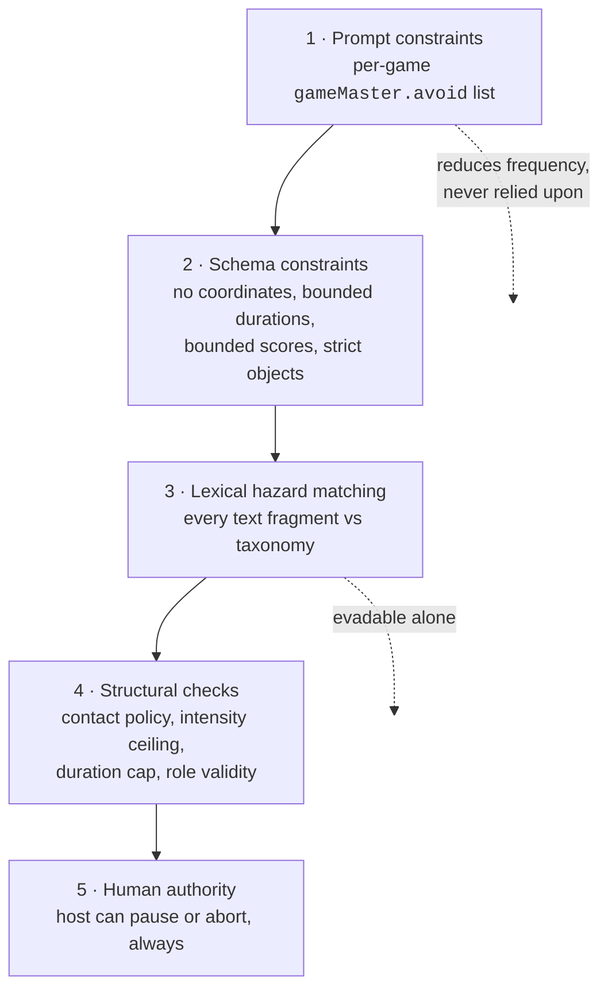

# Safety Architecture

> **Phase 1 status.** The hazard taxonomy, the verdict contract, and policy derivation are implemented
> and tested (`packages/safety`). The matching engine — the code that turns a proposal into a verdict
> — is **not implemented** and is not scheduled before Phase 3 (the Game Master). This document is the specification it will be built
> against.

---

## The commitment

**The AI is never the final safety authority.**

Not as a reviewer of its own output. Not as a reviewer of another model's output. Not with a better
prompt, not with a bigger model, not with a chain-of-thought preamble.

The reason is not that models are bad at recognising danger — they are often quite good at it. The
reason is that a safety control has to be **deterministic, inspectable, and total**, and a language
model is none of those. The same proposal must receive the same verdict every time. A rejection must
be explainable to a parent in one sentence. An unclassifiable input must come out the other side as a
rejection rather than as a coin flip.

So safety in TouchGrass is a pure function over validated data:

```ts
export type SafetyValidator<TProposal, TContext> = (
  proposal: TProposal,
  context: TContext,
) => SafetyVerdict;
```

Synchronous on purpose. A check that can `await` is a check that can hang, time out, and get skipped
under load — and forbidding I/O in the type also forbids the thing we must never do: ask a model
whether its own output was safe.

---

## Why this layer has to exist at all

The physical situation is unusual for software. Consider what the product actually does: a phone tells
a group of children to do something, outdoors, at speed, where the phone cannot see the ground, the
road, the pond, the fence, or the stranger on the path.

The system has **no map, no camera, no GPS, and no knowledge of the space**. It therefore has no way
to verify that any spatial instruction is safe. The only defensible posture is to never generate one
that could be unsafe, and to check every candidate against a fixed list of things that are never
acceptable regardless of context.

A concrete example of why schema validation is not enough. This proposal is **perfectly valid** under
`gameEventProposalSchema`:

```json
{
  "kind": "MODIFIER",
  "rationale": "The runners are coasting and need the area opened up.",
  "rule": "Runners may now cross the road to the far pavement for ten seconds.",
  "target": { "roleIds": ["runner"], "playerIds": [] },
  "durationSeconds": 10
}
```

Correct shape. Correct types. Within every bound. Plausible rationale. And it could kill a child.

Zod answers _"is this the right shape"_. Safety answers _"should a child in a field hear this"_. They
are different questions and need separate passes.

---

## The hazard taxonomy

Fifteen categories, implemented in `packages/safety/src/hazards.ts`. Each carries an id, a
description, a severity, a **rationale** explaining the real-world failure it prevents, and example
signals used as documentation and as test fixtures for the validator.

| Category                          | Severity | What it covers                                                                         |
| --------------------------------- | -------- | -------------------------------------------------------------------------------------- |
| `roads-and-traffic`               | critical | Roads, car parks, driveways, cycle paths, tram and rail lines                          |
| `climbing-and-heights`            | critical | Trees, walls, fences, play equipment, standing on or jumping down from anything raised |
| `water`                           | critical | Ponds, rivers, streams, canals, fountains, ditches, culverts, flooded ground           |
| `restricted-and-private-property` | critical | Private gardens, gated ground, building sites, buildings, vehicles                     |
| `weapons`                         | critical | Sticks as swords, stones as projectiles, anything repurposed to strike                 |
| `fire-and-heat`                   | critical | Flame, matches, lighters, barbecues, hot surfaces                                      |
| `forced-physical-contact`         | critical | Grabbing, holding, tackling, pushing, lifting, carrying, wrestling                     |
| `strangers`                       | critical | Approaching, following, photographing, or taking anything from people outside the game |
| `sensory-deprivation`             | critical | Blindfolds, closed eyes, covered ears while anyone is moving                           |
| `ingestion`                       | critical | Eating, tasting, licking, chewing, drinking anything found outdoors                    |
| `dangerous-objects`               | high     | Litter, glass, needles, scrap metal, tools, anything thrown or dug up                  |
| `dangerous-physical-challenge`    | high     | Exertion or poses beyond the game's declared intensity, breath-holding, spinning       |
| `wildlife-and-plants`             | high     | Animals, nests, hives; mushrooms, berries, sap, thorns, nettles; picking plants        |
| `isolation-and-separation`        | high     | Sending a player out of sight or earshot beyond what the game already declared         |
| `darkness-and-visibility`         | moderate | Play in the dark, in heavy weather, or where players cannot see the ground             |

Severity determines the disposition:

| Severity   | Effect                                                           |
| ---------- | ---------------------------------------------------------------- |
| `critical` | Reject the proposal, log it, never show it to players. No retry. |
| `high`     | Reject this proposal; the rest of the turn may proceed.          |
| `moderate` | Reject this proposal and allow one repair attempt.               |

`NON_NEGOTIABLE_HAZARDS` is **derived** from severity rather than maintained as a second hand-written
list — a test asserts the two agree. No configuration surface, no host toggle, and no policy may
switch off a critical category; `safetyPolicySchema` refuses any policy that omits one.

### Why each category is on the list

Every entry carries a `rationale` in code, and a test enforces that it is substantive. A hazard without
a defensible reason is the one that gets quietly deleted to fix a false positive. A few worth quoting:

- **`roads-and-traffic`** — "A running child who is watching a chaser is not watching for a car. This
  is the single most likely way an outdoor game kills someone, and it is the one hazard the system can
  never see for itself, because it has no map of what is past the hedge."
- **`fire-and-heat`** — "Ice & Fire names an element in its title. That is exactly the kind of thematic
  pull that produces a literal suggestion, so the elemental metaphor must be enforced as metaphor."
- **`ingestion`** — "Nature Challenge invites sensory exploration, and taste is a sense. Berries,
  mushrooms, and sap make that a poisoning route, so taste is removed from the game entirely."
- **`strangers`** — "A scavenger hunt will cheerfully suggest asking a passer-by for a clue. That is a
  safeguarding failure and a harassment risk in the same sentence."
- **`sensory-deprivation`** — "Blindfold variants are a classic party-game twist and are genuinely
  dangerous outdoors, where the ground is uneven and other players are running."

Notice the pattern: the most dangerous suggestions are the ones a well-meaning model is _most likely_
to produce, because they are the obvious way to make a game more exciting.

---

## Defence in depth

Safety is not one check. It is five layers, each of which would be insufficient alone.



**Layer 1 — prompt constraints.** Each game definition carries an `avoid` list in plain language, and
the schema requires it to be non-empty. Tag's list names roads, climbing, grabbing, blindfolds and
thrown objects explicitly. This _reduces the frequency_ of bad proposals. It is never relied upon: the
whole architecture assumes this layer will sometimes fail.

**Layer 2 — schema constraints.** Some hazards are designed out of the contract entirely. There is no
coordinate field anywhere, so a proposal cannot claim spatial authority. Durations max at 300s, score
deltas at ±10, proposals at three per turn. `.strict()` means an unexpected key is a rejection.

**Layer 3 — lexical hazard matching** _(planned)_. `proposalTextFragments()` already extracts every
human-readable string from any proposal kind — rationale, rule, instruction, landmark, announcement —
so the matcher has a single, exhaustive surface to scan. Word matching alone is both evadable and
over-triggering, which is why it is one layer of five rather than the mechanism.

**Layer 4 — structural checks** _(planned)_. These do not read text at all; they compare the proposal
against the derived policy. Does a `MODIFIER` introduce contact in a game whose `contactPolicy` is
`none`? Does `durationSeconds` exceed `policy.maxRuleDurationSeconds`? Does a `ROLE_ASSIGN` name a role
the definition does not have, or push a role past its maximum? These are exact, unevadable, and cannot
produce a false positive.

**Layer 5 — human authority.** `ABORT_SESSION` is legal from every non-terminal status, including the
lobby, and `PAUSE_SESSION` from any running state. **Stopping a game is never blocked by a state
check.** This is already implemented and tested: if someone is hurt, the host presses stop and the
engine complies, no matter what else is true.

---

## Policy derivation

A policy is **derived from the game definition**, never hand-assembled at a call site. That prevents a
session from accidentally running looser rules than its game declared.

```ts
const policy = policyFor(getGameDefinition('tag'), { supervisedByAdult: true });
```

| Field                    | Source                                                           |
| ------------------------ | ---------------------------------------------------------------- |
| `enforcedHazards`        | All fifteen categories, for every game                           |
| `contactPolicy`          | Mirrors `definition.safety.contactPolicy`                        |
| `maxIntensity`           | Mirrors `definition.safety.maxIntensity`                         |
| `separationExpected`     | Mirrors `definition.safety.involvesSeparation`                   |
| `maxRuleDurationSeconds` | Derived from intensity: low 300s, moderate 180s, high 120s       |
| `supervisedByAdult`      | Host-provided, **defaults to `false`** — the stricter assumption |

Three properties, each pinned by a test:

**Every game enforces every category.** Categories that do not apply to a game simply never match. The
alternative — per-game opt-in — would mean a contributor adding a sixth game ships it unsafe by
default if they forget a line.

**Harder games get shorter rules.** A high-intensity chase caps generated rules at 120 seconds; a
low-intensity nature walk gets 300. A demanding constraint held for five minutes is unsafe for the
least able player present, who is also the one least likely to say so in front of the group.

**A host can tighten, never loosen.** `maxRuleDurationSeconds` clamps downward only — asking for 9,999
yields the game ceiling. `supervisedByAdult: false` is the default, and setting it true only relaxes
moderate-severity rules, never critical ones.

---

## The verdict

```ts
interface SafetyVerdict {
  disposition: 'allow' | 'revise' | 'reject';
  violations: SafetyViolation[];
  policyVersion: string;
  durationMs: number;
}

interface SafetyViolation {
  hazard: HazardCategoryId;
  severity: HazardSeverity;
  field: string; // which proposal field triggered it
  evidence: string; // the exact substring or condition that matched
  explanation: string; // one sentence a host could read aloud
}
```

Four commitments are encoded in those types.

**There is no "unknown".** The disposition enum has three members and none of them means "not sure".
Anything the validator cannot classify is a reject. A game that fails closed is boring for one round;
a game that fails open is dangerous.

**A verdict always carries its reasons.** `evidence` and `explanation` are both required and both
non-empty — a test asserts a violation missing either is rejected by the schema. "Rejected" with no
explanation is useless to a host wondering why the Game Master went quiet, and useless to us tuning a
prompt.

**A verdict is data.** It is logged, replayable, and testable. The same proposal and the same policy
must always produce the same verdict.

**It is versioned.** `policyVersion` is stamped into every verdict so a historical log stays
interpretable after the rule set changes — which matters because the validator's regression suite will
replay real recorded turns against new rules.

---

## The audit trail

Every state change records where it came from. `EventSource` is `'engine' | 'human' |
'game-master'`, and a Phase 1 test asserts that no lifecycle entry is ever attributed to the model.

Once persistence exists, it stores per session:

- every proposal the model made, including its own stated `rationale`
- the verdict each one received, with its violations and `policyVersion`
- every proposal that was **rejected**, which is the more interesting half

That last point is the one worth defending. Rejected proposals are the primary safety signal. They
show which prompts drift toward hazards, which games tempt the model hardest, which categories fire
most, and whether a prompt change made things better or only different. Discarding them would mean
flying blind on the only metric that matters.

---

## What is explicitly out of scope

Being clear about the limits is part of the safety argument.

| Not claimed                    | Why                                                                                                                     |
| ------------------------------ | ----------------------------------------------------------------------------------------------------------------------- |
| Geofencing or map awareness    | No map, no GPS, no knowledge of the space. Players agree the boundary; the app references it.                           |
| Supervision                    | Software cannot watch children. The boundary-walk phase and the host controls support a human; they do not replace one. |
| Medical or fitness judgement   | The intensity ceiling is a crude proxy. It does not know who has asthma.                                                |
| Weather and darkness detection | `requiresDaylight` is declared per game, not sensed. A weather API is a future option, not a control.                   |
| Identity or age verification   | `supervisedByAdult` is a host assertion, not a verified fact, and it only ever tightens rules.                          |

The product's honest claim is narrower and testable: **no instruction reaches a player without passing
a deterministic check that a human can read, reason about, and have reviewed.**

---

## Validator scope (planned)

| Deliverable                                                | Location                               |
| ---------------------------------------------------------- | -------------------------------------- |
| Lexical hazard matcher over `proposalTextFragments()`      | `packages/safety/src/lexical.ts`       |
| Structural checks against the derived policy               | `packages/safety/src/structural.ts`    |
| `validateProposal()` composing both into a `SafetyVerdict` | `packages/safety/src/validate.ts`      |
| An adversarial corpus: proposals that must be rejected     | `packages/safety/src/__fixtures__/`    |
| False-positive corpus: safe proposals that must be allowed | same                                   |
| Golden tests over recorded real Gemma output               | `packages/safety/src/validate.test.ts` |

The two corpora matter equally. A validator that rejects everything is trivially "safe" and useless —
it would mean no twists, which means no product. The false-positive suite is what keeps the rules
honest.
