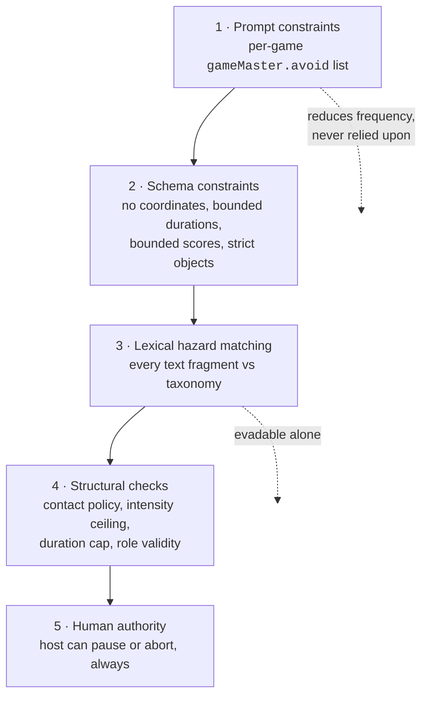

# Safety Architecture

> **Status: the validator gates the Game Master in live games.** A deterministic safety validator
> exists in `packages/safety`. A Game Master proposal that the engine has found legal is assessed
> against the safety policy of its game, and is handed to the engine only if no rule matched. This
> now happens for every Game Master turn in a live session, not only in tests. It is a fixed set
> of rules over the text and values of an event. It has no knowledge of the place a game is being
> played, and **it does not make the application safe**: see
> [What the validator cannot do](#what-the-validator-cannot-do).

**AI proposes; schema checks shape; domain validation checks legality; safety validation checks
real-world risk; the deterministic engine executes.**

---

## The commitment

**The AI is never the final safety authority.**

Not as a reviewer of its own output. Not as a reviewer of another model's output. Not with a better
prompt, not with a bigger model, not with a chain-of-thought preamble.

The reason is not that models are bad at recognising danger — they are often quite good at it. The
reason is that a safety control has to be **deterministic, inspectable, and total**, and a language
model is none of those. The same proposal must receive the same verdict every time. A rejection must
be explainable to a parent in one sentence. An unclassifiable input must come out the other side as a
rejection rather than as a coin flip.

So safety in TouchGrass is a pure function over validated data:

```ts
export type SafetyValidator<TProposal, TContext> = (
  proposal: TProposal,
  context: TContext,
) => SafetyVerdict;
```

Synchronous on purpose. A check that can `await` is a check that can hang, time out, and get skipped
under load — and forbidding I/O in the type also forbids the thing we must never do: ask a model
whether its own output was safe.

---

## Why this layer has to exist at all

The physical situation is unusual for software. Consider what the product actually does: a phone tells
a group of children to do something, outdoors, at speed, where the phone cannot see the ground, the
road, the pond, the fence, or the stranger on the path.

The system has **no map, no camera, no GPS, and no knowledge of the space**. It therefore has no way
to verify that any spatial instruction is safe. The only defensible posture is to never generate one
that could be unsafe, and to check every candidate against a fixed list of things that are never
acceptable regardless of context.

A concrete example of why schema validation is not enough. This event is **perfectly valid** under
`gameEventSchema`, and Tag supports `ZONE_CHANGE`:

```json
{
  "type": "ZONE_CHANGE",
  "modifier": "SAFE_ZONE",
  "zone": "the far pavement, across the road",
  "durationSeconds": 30
}
```

Correct shape. Correct types. Within every bound. And it could kill a child.

Zod answers _"is this the right shape"_. The engine answers _"is this legal in this game right
now"_. Safety answers _"should a child in a field hear this"_. They are different questions and need
separate passes. **Domain-valid does not mean safe**: the engine accepts the event above, and the
safety validator refuses it.

---

## The hazard taxonomy

Eighteen categories, implemented in `packages/safety/src/hazards.ts`. Each carries an id, a
description, a severity, a **rationale** explaining the real-world failure it prevents, and example
signals used as documentation and as test fixtures for the validator.

| Category                          | Severity | What it covers                                                                         |
| --------------------------------- | -------- | -------------------------------------------------------------------------------------- |
| `roads-and-traffic`               | critical | Roads, car parks, driveways, cycle paths, tram and rail lines                          |
| `climbing-and-heights`            | critical | Trees, walls, fences, play equipment, standing on or jumping down from anything raised |
| `water`                           | critical | Ponds, rivers, streams, canals, fountains, ditches, culverts, flooded ground           |
| `restricted-and-private-property` | critical | Private gardens, gated ground, building sites, buildings, vehicles                     |
| `weapons`                         | critical | Sticks as swords, stones as projectiles, anything repurposed to strike                 |
| `fire-and-heat`                   | critical | Flame, matches, lighters, barbecues, hot surfaces                                      |
| `forced-physical-contact`         | critical | Grabbing, holding, tackling, pushing, lifting, carrying, wrestling                     |
| `strangers`                       | critical | Approaching, following, photographing, or taking anything from people outside the game |
| `sensory-deprivation`             | critical | Blindfolds, closed eyes, covered ears while anyone is moving                           |
| `ingestion`                       | critical | Eating, tasting, licking, chewing, drinking anything found outdoors                    |
| `aggression-and-harassment`       | critical | Hurting, fighting, threatening, humiliating, bullying or coercing anyone               |
| `privacy`                         | critical | Photographing or recording people; collecting or sharing personal details              |
| `dangerous-objects`               | high     | Litter, glass, needles, scrap metal, tools, anything thrown or dug up                  |
| `dangerous-physical-challenge`    | high     | Exertion or poses beyond the game's declared intensity, breath-holding, spinning       |
| `wildlife-and-plants`             | high     | Animals, nests, hives; mushrooms, berries, sap, thorns, nettles; picking plants        |
| `isolation-and-separation`        | high     | Sending a player out of sight or earshot beyond what the game already declared         |
| `unassessable-instruction`        | high     | Text the rules cannot read, or an instruction that leaves the risky choice open        |
| `darkness-and-visibility`         | moderate | Play in the dark, in heavy weather, or where players cannot see the ground             |

Severity determines the disposition of a verdict:

| Violations found                                        | Disposition | Executed? |
| ------------------------------------------------------- | ----------- | --------- |
| none                                                    | `allow`     | yes       |
| any `critical` or `high`                                | `reject`    | no        |
| `moderate` only, no adult supervision                   | `reject`    | no        |
| `moderate` only, host confirmed an adult is supervising | `revise`    | no        |

Only `allow` lets an event through. `revise` records that the reason was a moderate one; nothing
rewrites the event, invents a replacement, or asks the model to try again.

`NON_NEGOTIABLE_HAZARDS` is **derived** from severity rather than maintained as a second hand-written
list — a test asserts the two agree. No configuration surface, no host toggle, and no policy may
switch off a critical category; `safetyPolicySchema` refuses any policy that omits one.

### Why each category is on the list

Every entry carries a `rationale` in code, and a test enforces that it is substantive. A hazard without
a defensible reason is the one that gets quietly deleted to fix a false positive. A few worth quoting:

- **`roads-and-traffic`** — "A running child who is watching a chaser is not watching for a car. This
  is the single most likely way an outdoor game kills someone, and it is the one hazard the system can
  never see for itself, because it has no map of what is past the hedge."
- **`fire-and-heat`** — "Ice & Fire names an element in its title. That is exactly the kind of thematic
  pull that produces a literal suggestion, so the elemental metaphor must be enforced as metaphor."
- **`ingestion`** — "Nature Challenge invites sensory exploration, and taste is a sense. Berries,
  mushrooms, and sap make that a poisoning route, so taste is removed from the game entirely."
- **`strangers`** — "A scavenger hunt will cheerfully suggest asking a passer-by for a clue. That is a
  safeguarding failure and a harassment risk in the same sentence."
- **`sensory-deprivation`** — "Blindfold variants are a classic party-game twist and are genuinely
  dangerous outdoors, where the ground is uneven and other players are running."

Notice the pattern: the most dangerous suggestions are the ones a well-meaning model is _most likely_
to produce, because they are the obvious way to make a game more exciting.

---

## Defence in depth

Safety is not one check. It is five layers, each of which would be insufficient alone.



**Layer 1 — prompt constraints.** Each game definition carries an `avoid` list in plain language, and
the schema requires it to be non-empty. Tag's list names roads, climbing, grabbing, blindfolds and
thrown objects explicitly. This _reduces the frequency_ of bad proposals. It is never relied upon: the
whole architecture assumes this layer will sometimes fail.

**Layer 2 — schema constraints.** Some hazards are designed out of the contract entirely. There is no
coordinate field anywhere, so an event cannot claim spatial authority. Durations are capped at 600
seconds, a challenge or objective is worth 1 to 10 points, and no event can set or reduce a score.
`.strict()` means an unexpected key is a rejection.

**Layer 3 — lexical hazard matching** (`rules.ts`, `text.ts`). Every string an event can carry to
players is checked: `zone` on `ZONE_CHANGE`, and `description` plus the model-chosen id on `CHALLENGE`
and `BONUS_OBJECTIVE`. That is the whole surface, and a new event kind does not compile until someone
decides which of its fields reach players. Text is normalised first (case, accents, punctuation,
full-width characters), then matched against a table of small named rules — `road-places`, `heights`,
`water`, `strangers`, `privacy` and so on — each tied to one hazard category. Word matching alone is
both evadable and over-triggering, which is why it is one layer of five rather than the mechanism.

**Layer 4 — structural checks** (`assess.ts`). These do not interpret sentences; they compare the
event against the derived policy. A demand (`CHALLENGE`, `BONUS_OBJECTIVE`, `RULE_MODIFIER`) may not
last longer than `policy.maxRuleDurationSeconds`. A game that declared `contactPolicy: 'none'` is held
to it: "high five another player" is refused in Hide & Seek and allowed in Tag. Whether a role, player
or power exists is not a safety question; the engine has already answered it before safety runs.

**Layer 5 — human authority.** `ABORT_SESSION` is legal from every non-terminal status, including the
lobby, and `PAUSE_SESSION` from any running state. **Stopping a game is never blocked by a state
check.** This is already implemented and tested: if someone is hurt, the host presses stop and the
engine complies, no matter what else is true.

How a person reaches it: the realtime transport (`@touchgrass/realtime`) lets the connection that
holds a game's host token send `PAUSE_SESSION`, `RESUME_SESSION`, `ABORT_SESSION` and
`REMOVE_PLAYER`. That is a capability, not an identity. Whoever has the token can stop the game, and
a host who has lost it, or whose device is off, cannot. The token is not encrypted in transit and
does not survive a restart. Players cannot stop a game through the transport; they can only stop
playing. There is no in-app button yet, because there is no client. So this layer is implemented in
the engine and reachable over the wire, and it still depends on a person holding the token.

---

## Policy derivation

A policy is **derived from the game definition**, never hand-assembled at a call site. That prevents a
session from accidentally running looser rules than its game declared.

```ts
const policy = policyFor(getGameDefinition('tag'), { supervisedByAdult: true });
```

| Field                    | Source                                                           |
| ------------------------ | ---------------------------------------------------------------- |
| `enforcedHazards`        | All eighteen categories, for every game                          |
| `contactPolicy`          | Mirrors `definition.safety.contactPolicy`                        |
| `maxIntensity`           | Mirrors `definition.safety.maxIntensity`                         |
| `separationExpected`     | Mirrors `definition.safety.involvesSeparation`                   |
| `maxRuleDurationSeconds` | Derived from intensity: low 300s, moderate 180s, high 120s       |
| `supervisedByAdult`      | Host-provided, **defaults to `false`** — the stricter assumption |

Three properties, each pinned by a test:

**Every game enforces every category.** Categories that do not apply to a game simply never match. The
alternative — per-game opt-in — would mean a contributor adding a sixth game ships it unsafe by
default if they forget a line.

**Harder games get shorter rules.** A high-intensity chase caps generated rules at 120 seconds; a
low-intensity nature walk gets 300. A demanding constraint held for five minutes is unsafe for the
least able player present, who is also the one least likely to say so in front of the group.

**A host can tighten, never loosen.** `maxRuleDurationSeconds` clamps downward only — asking for 9,999
yields the game ceiling. `supervisedByAdult: false` is the default. Setting it true changes one
thing: a verdict whose only violations are moderate is labelled `revise` instead of `reject`. Neither
is executed, so no host option turns a refusal into an application.

The validator derives the policy itself, from the registered definition of the state's game. A caller
passes options, never a policy and never a definition.

---

## The verdict

```ts
interface SafetyVerdict {
  disposition: 'allow' | 'revise' | 'reject';
  violations: SafetyViolation[];
  checkedFields: string[]; // the event fields that were examined
  policyVersion: string;
}

interface SafetyViolation {
  hazard: HazardCategoryId;
  severity: HazardSeverity;
  rule: string; // which rule matched, e.g. "road-places"
  field: string; // which event field triggered it
  evidence: string; // the exact words or condition that matched
  explanation: string; // one sentence a host could read aloud
}
```

**There is no "unknown".** The disposition enum has three members and none of them means "not sure".
Text the rules cannot read is a violation of `unassessable-instruction`, and so is an instruction that
leaves the choice open ("go anywhere you like", "whatever it takes"). A game that fails closed is
boring for one round; a game that fails open is dangerous.

**`allow` means no rule matched.** It is not a finding that an instruction is safe where the game is
being played.

**A verdict always carries its reasons.** `rule`, `evidence` and `explanation` are required and
non-empty. "Rejected" with no explanation is useless to a host wondering why the Game Master went
quiet, and useless to us tuning a prompt.

**A verdict is data, and deterministic.** The same event and the same policy always produce an
identical verdict. It carries no timing and no other value that differs between runs, and the
validator reads no clock, makes no network call and consults no model.

**It is versioned.** `policyVersion` is stamped into every verdict so a historical log stays
interpretable after the rule set changes.

---

## The validator

```
raw proposal
  → schema validation        parseGameMasterProposal   packages/ai
  → state-aware validation   validateExternalEvent     packages/game-engine
  → ValidatedGameEvent       legal in this game, now
  → safety validation        validateSafety            packages/safety
  → SafetyClearedEvent       no rule of the policy matched
  → engine                   applyValidatedEvent       packages/game-engine
```

```ts
assessEventSafety(event, policy): SafetyVerdict
validateSafety(validated, state, options?): Result<SafetyClearedEvent, SafetyRejection>
releaseClearedEvent(cleared): Result<ValidatedGameEvent, SafetyRejection>
```

- `assessEventSafety` is the pure assessment: an event and a policy in, a verdict out.
- `validateSafety` takes an event the engine has validated. It refuses anything the engine did not
  issue, an event validated for a different game or under a different game definition than the state names, and a state whose game is not registered
  (`NOT_EVALUATED`). It derives the policy, assesses the event, and returns either a
  `SafetyClearedEvent` or the verdict (`UNSAFE`).
- A `SafetyClearedEvent` can only come from `validateSafety`. A copy, a look-alike or one rebuilt from
  JSON is refused by `releaseClearedEvent`, which is the only way to get back the engine's validated
  event in order to apply it. The cleared event and the event inside it are frozen.
- The validator decides and returns a value. It does not apply events, award points, write history or
  change the state, the definition or the event. Execution stays with the engine, which still checks
  the event against the current state when it is applied.

**The rationale is not checked and is not trusted.** A proposal's `rationale` is the model talking
about its proposal. The validator is given the event only. A reassuring rationale ("this is safe and
supervised") cannot clear an unsafe event, and an alarming one does not block a safe event.

**Order.** Safety runs after the engine has found the event legal. An event that is both illegal and
unsafe is reported as illegal. Engine-only events never reach safety at all.

**Nothing is rewritten.** An unsafe event is refused as it stands. It is not softened, trimmed or
replaced, and the model is not asked for another.

**Nothing runs on its own.** There is no timer, schedule or trigger that asks the Game Master for a
turn, and no player-facing execution. `runGameMasterTurn` runs when a caller calls it.

---

## What the validator cannot do

It is a list of words and a few numeric limits. That is enough to refuse the obvious, and it is not a
safety guarantee.

- **It cannot see the place.** "The big oak" is allowed. Whether that oak stands beside a road is
  unknown to the system and always will be.
- **It can be evaded.** A misspelling, slang, a euphemism, or a hazard the rules do not list will not
  match. Text in another script, text with hidden characters and text spelled out letter by letter are
  refused as unreadable; "cl1mb" is not caught.
- **It over-triggers on purpose.** "Stay away from the road" is refused because it mentions a road.
  The rules do not understand sentences, and a safe instruction that has to name a hazard is refused
  with the unsafe ones. Several ordinary words (`bridge`, `garden`, `shop`, `adult`, `night`) are
  refused wherever they appear.
- **It covers Game Master proposals handed off through `@touchgrass/ai/handoff`.** The engine cannot
  depend on the safety package, so calling the engine's own `submitGameEvent` or `applyValidatedEvent`
  directly applies a legal event without a safety check. A host's own events take that path today.
- **It does not check display names or other player-supplied text.** Only events are assessed.
- **It is English only.**

## The audit trail

Every history entry records where it came from. `HistorySource` is `'engine' | 'human' |
'game-master'`: events the engine produces are recorded as `engine`, and an event submitted on
behalf of the Game Master is recorded as `game-master`. The engine's tests assert both.

In a live game, every Game Master turn produces a record for whoever listens (`onAudit`): the
session, the trigger, the model, the outcome, the stage at which a proposal was refused, and a
code. A proposal refused for safety is recorded as `REJECTED` at stage `SAFETY`. The record does
not include the proposal's text, the verdict's violations, or the rationale, and nothing stores it:
the development server prints it. A rejected proposal changes nothing in the game, is not broadcast
and is not saved.

The full verdict is still returned only to the caller of the hand-off. A later phase should store,
per session:

- every event the model proposed
- the verdict each one received, with its violations and `policyVersion`
- every proposal that was **rejected**, which is the more interesting half

That last point is the one worth defending. Rejected proposals are the primary safety signal. They
show which prompts drift toward hazards, which games tempt the model hardest, which categories fire
most, and whether a prompt change made things better or only different. Discarding them would mean
flying blind on the only metric that matters.

---

## The regression suite

`packages/safety/src/regression.test.ts` tests the validator on its own: no model, no provider, no
agent, no server. It exists so that a change anywhere in the AI system cannot quietly let an
unsafe event through.

- **Every event kind.** It is a table keyed by the seven kinds of event that can come from outside
  the engine, checked by the compiler, so a new kind cannot be added without an entry.
- **Every game.** Each case is run against the policy of all five game definitions.
- **Safe cases.** Places and instructions that must be allowed, including text the real model wrote.
- **Critical hazards.** Places and instructions that must be refused in every game under every
  combination of options, including claimed adult supervision and a requested longer time limit,
  and however they are capitalised, padded or dressed up with reassurance.
- **Unreadable text.** Refused, not guessed at.
- **Malformed events.** Refused by the engine's own schema before the validator is asked.
- **The boundary.** A timed demand is allowed at exactly the game's limit and refused one second
  over it. Configuration can shorten the limit and cannot lengthen it.
- **What reaches the engine.** Only an event the validator cleared: never a forged clearance,
  never one for a different game.

The kinds with no words for players and no demand (`POWER_UP`, `TIME_EXTENSION`, `ROLE_CHANGE`)
have nothing for the validator to assess. The suite asserts that it says so, by reporting that it
checked no fields, rather than claiming a check it did not make. What bounds those is the engine.

The Game Master's golden scenarios in [AI.md](./AI.md#evaluation) then show the same refusals
holding end to end, including after a tool call.

---

## What is explicitly out of scope

Being clear about the limits is part of the safety argument.

| Not claimed                    | Why                                                                                                                     |
| ------------------------------ | ----------------------------------------------------------------------------------------------------------------------- |
| That the application is safe   | The validator refuses what its rules recognise. Outdoor play has risks no rule list covers.                             |
| Geofencing or map awareness    | No map, no GPS, no knowledge of the space. Players agree the boundary; the app references it.                           |
| Supervision                    | Software cannot watch children. The boundary-walk phase and the host controls support a human; they do not replace one. |
| Medical or fitness judgement   | The intensity ceiling is a crude proxy. It does not know who has asthma.                                                |
| Weather and darkness detection | `requiresDaylight` is declared per game, not sensed. No weather or location service is consulted.                       |
| Identity or age verification   | `supervisedByAdult` is a host assertion, not a verified fact, and it never causes an event to be executed.              |

The claim that is made is narrower and testable: **a Game Master proposal handed off through
`@touchgrass/ai/handoff` reaches the engine only after a deterministic check that a human can read,
reason about, and have reviewed.**

---

## Where it lives

| Piece                                                       | Location                                   |
| ----------------------------------------------------------- | ------------------------------------------ |
| Hazard taxonomy                                             | `packages/safety/src/hazards.ts`           |
| Policy derivation                                           | `packages/safety/src/policy.ts`            |
| Verdict contract                                            | `packages/safety/src/verdict.ts`           |
| Text normalisation and the "cannot be read" check           | `packages/safety/src/text.ts`              |
| Lexical rules                                               | `packages/safety/src/rules.ts`             |
| `assessEventSafety`: text and structural checks → a verdict | `packages/safety/src/assess.ts`            |
| `validateSafety`, `SafetyClearedEvent`                      | `packages/safety/src/clearance.ts`         |
| The hand-off that calls it before the engine                | `packages/ai/src/handoff/handoff.ts`       |
| Where a live session's Game Master turn goes through it     | `packages/server/src/game-master-turns.ts` |

The tests hold two lists that matter equally: instructions that must be refused, and instructions that
must be allowed, including text the real `gemma3:4b` model produced ("Touch the gate and shout your
name.", "the old oak tree"). A validator that rejects everything is trivially "safe" and useless — it
would mean no twists, which means no product.

Not built: storing verdicts (there is no persistence), showing a refusal to a host (there is no game
UI), and any evaluation of the rules against a larger recorded corpus of model output.
