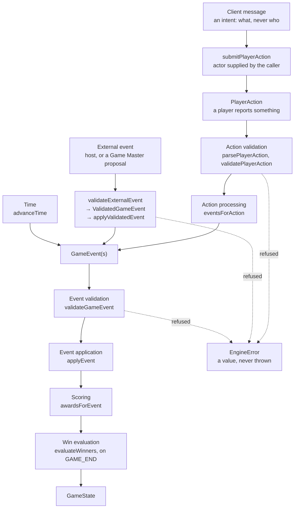
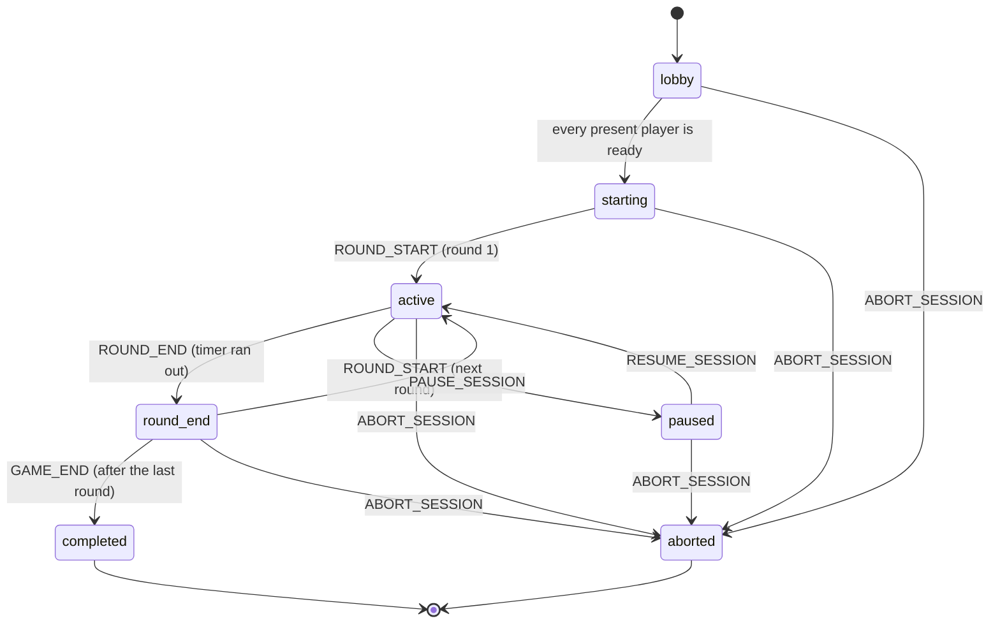

# Game engine

> **Status.** Tag and Hide & Seek are fully playable through the engine with no AI: lifecycle,
> rounds, timer, actions, events, scoring and winners are implemented and tested. The other three
> games have valid definitions but no rules or scoring.
>
> **Phase 5A establishes the deterministic multiplayer command boundary. Transport is implemented
> later.** There is no WebSocket server, no connection handling and no broadcast; see §6.

The engine is the only part of TouchGrass that can change a game. It has no dependency on a model,
a database, or a network, and it produces the same result on every machine.

---

## 1. The pipeline



| Step              | Module               | What it does                                                                              |
| ----------------- | -------------------- | ----------------------------------------------------------------------------------------- |
| Action validation | `validate.ts`        | Is this action allowed for this player, in this game, right now?                          |
| Action processing | `process-action.ts`  | Turns a valid action into the events the game's rules say it causes                       |
| Event validation  | `validate.ts`        | Is this event legal here? Applied to every event, whatever its origin                     |
| Event application | `apply-event.ts`     | Applies a validated event: the only place scores, roles in play, and player status change |
| Scoring           | `scoring.ts`         | Points that follow from the event, taken from the game definition                         |
| Win evaluation    | `win-conditions.ts`  | Decides the winners when the game ends                                                    |
| Time              | `time.ts`            | Ends rounds and the game when the supplied time says they are due                         |
| Host commands     | `reduce.ts`          | Join, leave, pause, resume, abort                                                         |
| External events   | `external-events.ts` | `validateExternalEvent`, `applyValidatedEvent`: the trust boundary for outside events     |
| Entry points      | `engine.ts`          | `step`, `replay`, `submitGameEvent`, `contextAt`                                          |
| Command boundary  | `submit-action.ts`   | `submitPlayerAction`: a client intent plus the actor the caller resolved for it           |

**An action is intent; an event is a fact.** No action schema has a score, role, or status field,
and every schema is strict, so a client has nowhere to put a state change.

Two actions are control actions and cause no event: `PLAYER_READY` sets the player's ready flag
(and starts the game once everyone is ready), and `PLAYER_ACCEPTED_EVENT` is recorded as an
acknowledgement and changes nothing else.

---

## 2. Game state

`GameState` is plain data and is enough to continue or replay the game on its own.

| Field                               | Meaning                                                                            |
| ----------------------------------- | ---------------------------------------------------------------------------------- |
| `id`, `joinCode`                    | Identity of this game                                                              |
| `gameId`                            | Which game definition is being played                                              |
| `status`                            | Lifecycle status (§3)                                                              |
| `phaseIndex`                        | Position in the definition's phase list                                            |
| `settings`                          | `totalRounds`, `roundDurationSeconds`, copied from the definition                  |
| `currentRound`                      | 0 before the first round                                                           |
| `timer`                             | `endsAt` and `pausedAt`, both epoch ms or null                                     |
| `players`                           | `PlayerState[]`: role, score, status (`active`, `out`, `left`), ready, held powers |
| `activeModifiers`                   | Zones, activated powers and freezes still in force, each with `expiresAt`          |
| `activeObjectives`                  | Challenges and bonus objectives that can still be completed                        |
| `history`                           | Every command, accepted action and applied event, in order                         |
| `winnerIds`                         | Set by the engine when the game completes                                          |
| `createdAt`, `startedAt`, `endedAt` | Epoch ms supplied by the caller                                                    |
| `randomSeed`                        | Seed for every random choice                                                       |

The schema also rejects inconsistent states: duplicate ids, a round beyond the total, gaps in
history, `endedAt` without a terminal status, a running round without an end time, `pausedAt`
without a pause, winners on a game that has not completed.

Each history entry records its `source` (`engine`, `human`, or `game-master`), what it was (a
command, an action, an event, or the role assignment), and the score awards it caused.

---

## 3. Lifecycle



- **Starting needs no host.** When a `PLAYER_READY` makes every present player ready, and there are
  at least `minPlayers` of them, the engine assigns roles from the stored seed (`starting`) and
  applies `ROUND_START` for round 1 (`active`). Both happen in that same step.
- **Rounds end on time only.** When the timer runs out the engine applies `ROUND_END`, then either
  `ROUND_START` for the next round or, after the last round, `GAME_END`.
- **`starting` and `round_end` are passed through within one step.** They are never a resting state;
  they are visible in the history.
- **A paused game cannot complete.** It can only resume or be aborted. Time does not run while paused.
- **Abort is always possible** from any status that is not already terminal.
- **Nothing is accepted after `completed` or `aborted`.**

The table is `LIFECYCLE_TRANSITIONS` in `state.ts`. Status values are lower-case in code.

There is no start command and no complete command.

---

## 4. Deterministic time

The engine never reads a clock and has no timers. Every entry point takes an `EngineContext`:

```ts
interface EngineContext {
  now: number; // the engine's clock for this step, epoch ms
  nextEntryId: (sequence: number) => string;
}
```

`contextAt(clock)` builds one from a `Clock` in `@touchgrass/shared`; tests use `fixedClock`.

`advanceTime(state, ctx)` does everything that was due by `ctx.now`: it ends rounds whose `endsAt`
has passed, starts the next round or ends the game, and drops expired modifiers and objectives.
Commands, actions and external events all call it first, so nothing is processed against a round
that has already run out.

- **Events are stamped with the time they were due**, not the time the caller noticed. Advancing in
  one large step or many small ones gives an identical state; a test asserts this.
- **Several rounds can elapse in one advance.**
- **Time cannot go backwards**; that is refused.
- **Pause freezes the clock.** `PAUSE_SESSION` records `pausedAt`. `RESUME_SESSION` moves `endsAt` and
  every modifier and objective expiry forward by the length of the pause.
- **An expiry equal to `now` has expired.**

---

## 5. Player actions

| Action                       | Fields                       | Result                                         |
| ---------------------------- | ---------------------------- | ---------------------------------------------- |
| `PLAYER_READY`               | `playerId`                   | Ready flag set; may start the game. Lobby only |
| `PLAYER_TAGGED`              | `playerId`, `targetPlayerId` | `ROLE_CHANGE` with a `TAGGED` cause (Tag)      |
| `PLAYER_FOUND`               | `playerId`, `targetPlayerId` | `PLAYER_OUT` with reason `FOUND` (Hide & Seek) |
| `PLAYER_ACTIVATED_POWER`     | `playerId`, `powerId`        | `POWER_ACTIVATED`                              |
| `PLAYER_COMPLETED_CHALLENGE` | `playerId`, `challengeId`    | `OBJECTIVE_COMPLETED`                          |
| `PLAYER_ACCEPTED_EVENT`      | `playerId`, `eventId`        | Recorded only                                  |

Which event a tag or a find produces comes from the game's rule, not from the action name: a rule
with outcome `SWAP_ROLES` produces a `ROLE_CHANGE`, one with `TARGET_OUT` produces a `PLAYER_OUT`.

The engine cannot see the field. It does not check that a tag physically happened; it checks that
the report is one the rules allow from that player at that moment.

**What each action needs.** "Present" means in the game and not left; "playing" means present and
not out for the round.

| Action                       | Game status | Actor   | Also required                                                                    |
| ---------------------------- | ----------- | ------- | -------------------------------------------------------------------------------- |
| `PLAYER_READY`               | `lobby`     | present | —                                                                                |
| `PLAYER_TAGGED`              | `active`    | playing | Target is playing; a rule lets the actor's role tag the target's; no live shield |
| `PLAYER_FOUND`               | `active`    | playing | Target is playing; a rule lets the actor's role find the target's                |
| `PLAYER_ACTIVATED_POWER`     | `active`    | playing | The actor holds the power                                                        |
| `PLAYER_COMPLETED_CHALLENGE` | `active`    | playing | The objective is active, the actor is eligible and has not already completed it  |
| `PLAYER_ACCEPTED_EVENT`      | `active`    | playing | `eventId` is an event entry in this game's history                               |

Every action must also be one the game definition lists, and nothing is accepted once a game has
ended or while it is paused.

---

## 6. The multiplayer command boundary

> Phase 5A establishes the deterministic multiplayer command boundary. Transport is implemented
> later.

```
Client
  ↓  intent (what, never who)        + actor id, supplied by the caller
PlayerAction
  ↓  action validation
deterministic action processing
  ↓
GameEvent(s)
  ↓  event validation
event application
  ↓
GameState
```

```ts
submitPlayerAction(state, actorId, intent, ctx): Result<PlayerActionOutcome, EngineError>

interface PlayerActionOutcome {
  state: GameState; // the state to continue with
  action: PlayerAction; // the action as recorded, with the actor filled in
  entries: HistoryEntry[]; // what this step added to the history, in order
}
```

**The actor is not in the message.** A `PlayerAction` names its actor in `playerId`. If a client
supplied that field, any client could act as any player. So a client sends a **player intent**: the
same payload as the action, with no `playerId`. The intent schemas are strict, so a message that
includes a `playerId` — or a score, a role, a status, or anything else — is refused, not ignored. The
caller passes the actor separately, and `submitPlayerAction` is the only place the two are joined.

**This is domain authorisation, not authentication.** The engine checks that the actor is a player
in this game who may do this now. It does not know how the caller decided which player a client is;
there are no accounts, tokens or sessions, and nothing about a connection is stored in `GameState`.
A realtime server added later owns that association and passes the player id it resolved. The
transport supplies actor identity; the client does not.

**`PlayerIntent` is untrusted input; `PlayerAction` is the domain action.** An intent comes from
outside and has no actor. An action contains its actor and is what the engine records in history and
what `replay` reads back. `processPlayerAction` and `step` take a `PlayerAction`, actor included, so
they are for replaying recorded actions and for code that already holds an authoritative action.
They must not be handed a client's message: that is what `submitPlayerAction` is for.

**Host commands are not part of this boundary.** Joining, leaving, pausing, resuming and aborting
are host commands handled by `reduce`. No intent can express one, and `submitPlayerAction` refuses a
message that tries. A command names no actor and `GameState` records no host, so the engine cannot
tell who issued one. Before any command is reachable from a client it needs its own authorised
boundary, which does not exist yet and is not designed here.

**It is the same engine path.** `submitPlayerAction` builds the action and calls
`processPlayerAction`, so the result is identical to processing that action directly. An action
never becomes an event without `validateGameEvent`, and no function accepts a partial state.

**A refusal changes nothing.** The caller's state is left exactly as it was: no
entry is recorded, no event applied, no point awarded, no role or power changed, and no time
advanced, including a round that had run out by the time the refused message arrived.

**The entries are what a caller would announce.** `entries` holds the history entries the step
added: any round that ended because time had passed, the action, the events it caused and their
awards. Each carries its `sequence`, which is its position in the game with no gaps.

### One state, one input at a time

A game has one authoritative state. The engine is a pure function, so it does not hold that state
and cannot serialise access to it; whoever holds it must give the engine one input at a time and keep
the state that comes back.

- Two messages that arrive together are processed one after the other. The second is judged against
  the state the first produced, and is refused by the ordinary rules if it is no longer legal: a
  tagger's second tag is refused because they are now a runner, and a second report of the same find
  is refused because the hider is already out.
- The order the holder chooses can decide the outcome. A shield raised just before a tag blocks it;
  raised just after, it does not undo it. The engine does not rank simultaneous messages.
- Calling the engine twice with the same state gives two separate results. Both claim the same
  history positions. A holder must keep only one of them.

**No revision field was added.** History is append-only and numbered without gaps, so within the
one line of states a holder keeps, `state.history.length` gives a state's position, and a store that
later needs compare-and-set can use it. It does not tell two diverged copies apart: both results of
the double call above have the same length. The engine never needs to, because it works on whatever
single state it is given; not forking that state is the holder's job. Clients are not asked to send
the revision they last saw: an action is valid or not against the current game, and refusing a tag
because an unrelated event arrived first would be worse than judging it by the rules. If a transport
wants to drop messages that are too old, it can do that before calling the engine.

**Duplicate delivery is a transport concern and is not handled here.** There is no message id, and
the engine does not recognise the same message arriving twice. The rules give some protection and
no guarantee:

- Usually the first message changes who may act, so the second is refused: a repeated tag, find,
  power activation or objective completion.
- A late duplicate can be legal again. If a tag is followed by a tag back, a second copy of the
  first tag is a valid new tag and scores.
- `PLAYER_READY` in the lobby and `PLAYER_ACCEPTED_EVENT` are recorded each time they arrive, adding
  a history entry and changing nothing else.

Recognising duplicates, and limiting how often a client may send, belong to the layer that receives
messages and holds the state.

### Two separate inputs

Player actions and AI proposals are two separate inputs to the deterministic engine.

```
PlayerAction → engine

GameState → Game Master → proposal → schema → domain validation → safety → engine
```

Processing a player action never calls a model. The Game Master is asked for a proposal only when a
caller asks, and that proposal reaches the engine through its own validation and the safety
validator. Neither path can apply anything the engine has not validated.

---

## 7. Game events

**The ten kinds of the project brief:**

| Event             | Fields                                                                 | Origin                             |
| ----------------- | ---------------------------------------------------------------------- | ---------------------------------- |
| `ROUND_START`     | `round`, `durationSeconds`                                             | Engine only                        |
| `ROUND_END`       | `round`                                                                | Engine only                        |
| `GAME_END`        | `reason` (`ROUNDS_COMPLETE`)                                           | Engine only                        |
| `ZONE_CHANGE`     | `modifier` (`SAFE_ZONE` or `MOVING_ZONE`), `zone`, `durationSeconds`   | External                           |
| `CHALLENGE`       | `challengeId`, `description`, `playerIds`, `points`, `durationSeconds` | External                           |
| `POWER_UP`        | `playerId`, `powerId` — grants a power to hold                         | External                           |
| `RULE_MODIFIER`   | `modifier` (`FREEZE_PERIOD`), `roleIds`, `durationSeconds`             | External                           |
| `BONUS_OBJECTIVE` | `objectiveId`, `description`, `points`, `durationSeconds`              | External                           |
| `TIME_EXTENSION`  | `seconds`                                                              | External                           |
| `ROLE_CHANGE`     | `assignments`, optional `cause`                                        | External, or engine with a `cause` |

**Three engine-derived kinds, added in Phase 2B** because the ten cannot state these facts:

| Event                 | Fields                                   | Produced by                               |
| --------------------- | ---------------------------------------- | ----------------------------------------- |
| `PLAYER_OUT`          | `playerId`, `byPlayerId`, `reason`       | A find (or tag) under a `TARGET_OUT` rule |
| `POWER_ACTIVATED`     | `playerId`, `powerId`, `durationSeconds` | `PLAYER_ACTIVATED_POWER`                  |
| `OBJECTIVE_COMPLETED` | `playerId`, `objectiveId`, `points`      | `PLAYER_COMPLETED_CHALLENGE`              |

There is no event that sets a score or writes arbitrary state.

**What an external source may send.** Only the seven "External" kinds, and only those the game
definition lists. Lifecycle and derived kinds are refused, and so is a `ROLE_CHANGE` that carries a
`cause` — otherwise an outside event could claim to be a tag and collect its points.

**The trust boundary for external events** (`external-events.ts`). Schema-valid does not mean
game-valid: a well-formed event can name a player who is not in the game. So an outside event
reaches the reducer in two steps, and cannot skip the first:

```ts
validateExternalEvent(state, input, source, ctx): Result<ValidatedGameEvent, EngineError>
applyValidatedEvent(state, validated, ctx): Result<GameState, EngineError>
```

- `validateExternalEvent` takes untrusted input. It checks the schema, refuses engine-only kinds and
  causes, brings the game up to `ctx.now`, and then runs the same `validateGameEvent` rules used for
  every event: the players, roles and powers named must exist, a player must not already hold the
  power, role limits must hold, the modifier must be allowed, and a round must be running. It
  changes nothing.
- The game definition is always the registered one for the state's game id. A caller cannot pass
  its own, so a modified copy of a definition cannot widen what is accepted.
- A `ValidatedGameEvent` can only come from that function. It is bound to the state it was checked
  against. `applyValidatedEvent` refuses a look-alike object or a copy, an event validated for
  another game, one validated on a different branch of the same game, and one validated before the
  game moved on (including into the next round). A state reloaded from storage counts as a different
  state: validate again after loading.
- "Validated" means legal in the game. It does not mean safe; the engine has no safety check and
  does not depend on the safety package. The safety validator (`@touchgrass/safety`) takes a
  `ValidatedGameEvent` as its input and is run by the Game Master hand-off before
  `applyValidatedEvent`. Calling `submitGameEvent` or `applyValidatedEvent` directly applies a legal
  event with no safety check.
- The event inside a `ValidatedGameEvent` is frozen all the way down, so it cannot be edited between
  being checked and being applied. `isValidatedGameEvent(value)` says whether a value is one the
  engine issued; it lets a later stage refuse a look-alike.
- `applyValidatedEvent` then applies it, validating once more as every application does.
- Nothing is repaired: an unknown player, role or power is a refusal, and the state is untouched.

`submitGameEvent` is those two calls in a row, for callers that do not need to see the validated
event.

**What each event does when applied:**

| Event                 | Effect                                                                          |
| --------------------- | ------------------------------------------------------------------------------- |
| `ROUND_START`         | Status `active`; sets the round and the timer; players who were out are back in |
| `ROUND_END`           | Status `round_end`; clears the timer; round scoring                             |
| `GAME_END`            | Status `completed`; sets `endedAt` and `winnerIds`                              |
| `ZONE_CHANGE`         | Adds a zone to `activeModifiers` until it expires                               |
| `RULE_MODIFIER`       | Adds a freeze to `activeModifiers` until it expires                             |
| `CHALLENGE`           | Adds an objective for the named players                                         |
| `BONUS_OBJECTIVE`     | Adds an objective open to everyone                                              |
| `OBJECTIVE_COMPLETED` | Marks the player as having completed it; awards its points                      |
| `POWER_UP`            | Adds the power to the player's held powers                                      |
| `POWER_ACTIVATED`     | Moves the power from held to `activeModifiers` with its expiry                  |
| `TIME_EXTENSION`      | Moves the round's end time later                                                |
| `ROLE_CHANGE`         | Sets the named players' roles; with a `TAGGED` cause, awards `TAG_MADE`         |
| `PLAYER_OUT`          | Sets the player's status to `out`; awards `FOUND_PLAYER`                        |

**Stored but not enforced.** A zone and a freeze period are recorded and expire, and nothing more.
The engine cannot see where players are, and no behaviour was approved for `FREEZE_PERIOD`, so it
does not block any action. A test pins this.

### Why events are deterministic

- **Complete.** Every value needed to apply an event is in the event, the game definition, or the
  state. Nothing is asked what was meant.
- **Closed.** Thirteen shapes, no free-form data field, strict schemas.
- **Bounded.** Durations 5–600 s, points 1–10, extension 5–300 s, 10 rounds, 4 role assignments.
  These are validation limits, not game rules.
- **No time or randomness of their own.** An event carries a duration; the expiry is computed from
  the time passed to the engine.
- **A zone is words, not a position.** There are no coordinate fields.

---

## 8. Tag

| Rule    | Value                                                               |
| ------- | ------------------------------------------------------------------- |
| Players | 2–4: exactly one tagger, everyone else a runner                     |
| Rounds  | 3 rounds of 180 seconds                                             |
| Tagging | The tagger reports tagging a runner; they swap roles (`SWAP_ROLES`) |
| Scoring | `TAG_MADE` +2 to the tagger; `ROUND_SURVIVED` +1 at round end       |
| Power   | `shield`: `TAG_IMMUNITY` for 20 seconds once activated              |
| Winner  | `HIGHEST_SCORE`                                                     |

- **`ROUND_SURVIVED`** goes to every player who is a runner when the round ends and was not tagged
  during that round. A player who started the round as tagger, tagged someone, and was not tagged
  back therefore earns it.
- **A shield** is granted by a `POWER_UP` event and held until its holder activates it. Holding one
  gives no protection. While active, a tag on its holder is refused. It protects only its holder and
  lapses exactly 20 seconds after activation. A player cannot be given a shield while holding or
  using one.
- **Roles carry over** from one round to the next: whoever is the tagger when a round ends is the
  tagger when the next begins.
- A runner cannot tag; nobody can tag themselves or a player who is not in the game.

---

## 9. Hide & Seek

| Rule    | Value                                                                               |
| ------- | ----------------------------------------------------------------------------------- |
| Players | 2–4: exactly one seeker, everyone else a hider                                      |
| Rounds  | 3 rounds of 300 seconds                                                             |
| Finding | The seeker reports finding a hider, who is out for the round (`TARGET_OUT`)         |
| Scoring | `FOUND_PLAYER` +2 to the seeker; `STAYED_HIDDEN` +3 and `ALL_FOUND` +2 at round end |
| Winner  | `HIGHEST_SCORE`                                                                     |

- **A found hider keeps the hider role** and has status `out` until the next round starts.
- **`STAYED_HIDDEN`** goes to each hider who is not out when the round ends.
- **`ALL_FOUND`** goes to the seeker at round end if every hider is out.
- **The round does not end early** when everyone has been found; rounds end on time only.
- **The seeker is the same player in every round.** Rotation was not specified and is not implemented.
- A hider cannot report a find; a hider who is out cannot be found again that round.

---

## 10. Scoring

Scoring is data in the game definition (`scoring: [{ trigger, points }]`). The engine adds points
when it applies the event that earns them, and writes each award — player, reason, points — onto
that event's history entry.

| Reason                | Awarded when                                               | To               |
| --------------------- | ---------------------------------------------------------- | ---------------- |
| `TAG_MADE`            | A `ROLE_CHANGE` with a `TAGGED` cause is applied           | The tagger       |
| `FOUND_PLAYER`        | A `PLAYER_OUT` with reason `FOUND` is applied              | The seeker       |
| `ROUND_SURVIVED`      | `ROUND_END`, per `SWAP_ROLES` rule                         | Untagged runners |
| `STAYED_HIDDEN`       | `ROUND_END`, per `TARGET_OUT` rule                         | Hiders still in  |
| `ALL_FOUND`           | `ROUND_END`, per `TARGET_OUT` rule, if all targets are out | The seeker       |
| `OBJECTIVE_COMPLETED` | An `OBJECTIVE_COMPLETED` is applied                        | That player      |

A trigger a definition does not list is worth nothing in that game. Awards are always positive, so
a score never goes down and never becomes negative. Nothing outside the engine can award points.

---

## 11. Win conditions

`HIGHEST_SCORE` is the only win condition. It is evaluated when `GAME_END` is applied, and the
result is stored in `winnerIds`.

**Ties:** every player level on the highest score wins. `winnerIds` lists them in the order they
joined. Players who left the game cannot win. An aborted game has no winners.

---

## 12. Validation and errors

**Schema validation (Zod)** answers "is it well formed": `parsePlayerAction`, `parseGameEvent`,
`gameStateSchema`, `gameDefinitionSchema`.

**Domain validation** answers "is it legal here and now": `validatePlayerAction` and
`validateGameEvent` read the definition and the state and change nothing.

A refusal is returned as `Result<T, EngineError>`; nothing is thrown, and the caller's state is
untouched.

| Code                         | Meaning                                                                                                          |
| ---------------------------- | ---------------------------------------------------------------------------------------------------------------- |
| `INVALID_GAME_CONFIGURATION` | Unknown game definition                                                                                          |
| `INVALID_STATE_TRANSITION`   | The status does not allow it; or time going backwards                                                            |
| `GAME_ALREADY_STARTED`       | Joining after the lobby                                                                                          |
| `GAME_ALREADY_COMPLETED`     | Anything after `completed` or `aborted`                                                                          |
| `INVALID_PLAYER`             | Player not in the game, or has left                                                                              |
| `DUPLICATE_PLAYER`           | Player already joined                                                                                            |
| `PLAYER_LIMIT_EXCEEDED`      | Game is full                                                                                                     |
| `NOT_ENOUGH_PLAYERS`         | Roles cannot be filled                                                                                           |
| `INVALID_ROLE`               | Unknown role; actor's role may not do this; role limits broken                                                   |
| `INVALID_PHASE`              | No further phase                                                                                                 |
| `INVALID_ACTION`             | Malformed action; not this game's action; player out; shielded target; power not held; objective not completable |
| `INVALID_EVENT`              | Malformed event; wrong round; unknown power; duplicate objective; forged cause                                   |
| `UNSUPPORTED_EVENT`          | Event kind not supported by this game, or not allowed from outside                                               |
| `INVALID_MODIFIER`           | Modifier not allowed in this game                                                                                |
| `INVALID_GAME_STATE`         | Declared; nothing returns it yet                                                                                 |

---

## 13. Why AI cannot change state directly

A model's output varies between runs, cannot be relied on to respect limits, and cannot be audited
after the fact. So no model writes to `GameState`, and the engine is built so that it could not:

- The only way in for a model is the external-event boundary: `validateExternalEvent` takes
  untrusted input and checks it against the event schema and then against the game, and only the
  `ValidatedGameEvent` it issues can be applied.
- It can send only the seven external event kinds, and only those the game supports.
- It cannot send a lifecycle event, so it cannot start or end a round or the game.
- It cannot send a derived event or a caused `ROLE_CHANGE`, so it cannot fake a tag, a find, or a
  completed objective.
- There is no event that sets a score, and winners are computed by the engine.
- Every applied event is recorded in history with its source, so "did a model cause this?" can be
  answered from the data.

The engine itself involves no AI. The Game Master's proposals reach it through this boundary, from
the hand-off module in `packages/ai` (see [AI.md](../../AI.md)).

---

## 14. Why the engine is deterministic

- Every entry point is a pure function of the state, the input, and the context.
- The clock value comes in through `EngineContext`; nothing calls `Date.now()`, and there are no
  timers or sleeps. A test replaces `Date.now` and `Math.random` with functions that throw and plays
  a full game.
- Randomness (role assignment) comes from `createRng(state.randomSeed)` in `@touchgrass/shared`.
- State holds absolute times only.
- The engine imports `@touchgrass/game-definitions`, `@touchgrass/shared` and `zod`, and nothing else.

Tests assert that replaying recorded inputs rebuilds an identical state, that a state serialised to
JSON mid-game continues identically, and that refused inputs leave the state unchanged. A seeded
randomised test feeds 400 valid and invalid inputs to each game and checks after every one that the
state is schema-valid, scores never fall, and role limits hold.

---

## 15. Known limits

1. **Tag-backs are allowed.** Two players can tag each other back and forth for +2 each time. No
   cooldown or "no tag-back" rule was specified, so none exists.
2. **A player leaving mid-game is not handled specially.** If the tagger or seeker is removed, the
   game continues without one.
3. **The seeker does not rotate** between rounds.
4. **Zones and freeze periods have no effect** beyond being recorded.
5. **Settings cannot be overridden** when a game is created; it always uses its definition's.
6. **Ice & Fire, Treasure Hunt and Nature Challenge** have no rules or scoring. A game of one runs
   its single round on the timer and every player ties on 0, or on objective points where the game
   allows objectives.
7. **`ADVANCE_PHASE`** still exists as a host command and is independent of rounds.
8. **Host commands have no actor.** `reduce` does not say who issued a pause, an abort or a removal,
   and `GameState` records no host, so the engine cannot check that a command came from one.
   Whatever calls `reduce` is trusted to have decided that.
9. **A message delivered twice is not deduplicated**, and nothing limits how often a client may
   send (see §6).
